# Отчет по лабораторной работе 2

МИНИСТЕРСТВО НАУКИ И ВЫСШЕГО ОБРАЗОВАНИЯ
РОССИЙСКОЙ ФЕДЕРАЦИИ
Федеральное государственное автономное
образовательное учреждение высшего образования
«СЕВЕРО-КАВКАЗСКИЙ ФЕДЕРАЛЬНЫЙ УНИВЕРСИТЕТ»
Институт информационных технологий и кибер безопасности
Департамент цифровых, робототехнических систем и электроники
Кафедра программной инженерии

**Тема** - HTTP-методы и CRUD в Flask

**Вариант** - 1, повышенный (продвинутый) уровень

**Выполнил:**
Студент группы ПИЖ-б-о-25-2 (2),
направление подготовки: 09.03.04
“Программная инженерия”
Кравцун Михаил Алексеевич

**Проверил:**
Заведующая МИБК
Новикова Елена Николаевна


---

## Репозиторий

[GitHub - лабораторная работа № 2](https://github.com/WhXteBeXr/backend-introduction/tree/main/lab2)

## Цель работы

Освоить обработку HTTP-методов в Flask, реализовать CRUD-операции над коллекцией задач в памяти сервера и научиться возвращать корректные HTTP-коды ответов.

## Постановка задачи

Разработать API для управления задачами. Выполнить вариант 1 повышенного уровня, включая требования базового и среднего уровней.

| Уровень | Требования |
| --- | --- |
| Базовый | Список задач, получение по ID, создание, обновление и удаление. Поля id, title, done. Обработка отсутствующей задачи |
| Средний | Поля priority и deadline, валидация, поиск по названию, сортировка, пагинация, статусы 201, 204 и 400 |
| Продвинутый | Частичное обновление, массовое создание и удаление, статистика выполненных задач, связи по приоритету, логирование в access.log, глобальная обработка ошибок |

## Теоретическая часть

CRUD объединяет четыре операции над ресурсами - создание, чтение, обновление и удаление. В HTTP API ресурс определяется адресом, а действие над ним задаётся методом запроса.

| Операция | Метод | Назначение |
| --- | --- | --- |
| Create | POST | Создание задачи |
| Read | GET | Получение списка или отдельной задачи |
| Update | PUT | Замена изменяемых полей задачи |
| Update | PATCH | Обновление переданных полей |
| Delete | DELETE | Удаление задачи или всей коллекции |

GET является безопасным методом, поскольку получение задачи не меняет её состояние. GET, PUT и DELETE идемпотентны - повторение одинакового запроса сохраняет итоговое состояние ресурса. При повторном DELETE код ответа может измениться с 204 на 404. POST создаёт новую запись при каждом успешном обращении.

Данные передаются в JSON. Объект задачи содержит именованные поля, а коллекция задач представляется массивом. Заголовок Content-Type сообщает формат тела запроса или ответа.

| Статус | Назначение |
| --- | --- |
| 200 OK | Успешное чтение или обновление |
| 201 Created | Создание одной или нескольких задач |
| 204 No Content | Удаление с пустым телом ответа |
| 400 Bad Request | Некорректное тело или параметры запроса |
| 404 Not Found | Задача или маршрут отсутствует |
| 405 Method Not Allowed | Метод не поддерживается данным маршрутом |
| 500 Internal Server Error | Непредвиденная ошибка сервера |

## Исходные файлы

[server.py](server.py) содержит приложение Flask, коллекцию задач, проверку данных, обработчики маршрутов и ошибок. Поиск задачи выполняется функцией find_task, значения полей для создания и полной замены подготавливает task_fields. Журнал запросов сохраняется в access.log в каталоге лабораторной работы.

## Существенные детали

- Задачи хранятся в списке словарей в памяти одного процесса. При перезапуске восстанавливаются три исходные записи.
- Сервер назначает идентификаторы последовательно. Удаление задач сохраняет значение счётчика.
- POST и PUT требуют название задачи. PATCH проверяет и изменяет только переданные разрешённые поля.
- Перед массовым созданием проверяется весь массив. Ошибка одной записи отклоняет пакет до изменения коллекции.
- Поиск выполняется до сортировки и пагинации. Поле count показывает число задач в конечной выдаче.
- При сортировке по сроку задачи без даты помещаются в конец при обоих направлениях. Приоритеты сортируются как строки.
- Каждое обращение записывается в журнал с временем, методом и адресом с query-параметрами.

## Запуск

Из корня репозитория в окружении с установленным Flask выполняется команда

```bash
python lab2/server.py
```

Базовый адрес сервера - `http://localhost:3001`. Запросы выполняются через Postman, Thunder Client или другой HTTP-клиент. Для POST, PUT и PATCH с JSON-телом задаётся заголовок `Content-Type: application/json`.

## Описание API и результаты выполнения

### Модель задачи

| Поле | Тип | Правила |
| --- | --- | --- |
| id | integer | Назначается сервером, первое значение равно 0 |
| title | string | Обязательно для POST и PUT. Должно содержать хотя бы один непробельный символ |
| done | boolean | Признак выполнения, по умолчанию false |
| priority | string | low, medium или high, по умолчанию medium |
| deadline | string или null | Существующая дата в формате YYYY-MM-DD либо null, по умолчанию null |

Для создания и обновления требуется JSON-объект. Неизвестные поля игнорируются. Передача id в теле не изменяет идентификатор задачи. Для PUT пропущенные необязательные поля получают значения по умолчанию. Для PATCH пропущенные поля сохраняют значения, пустой объект допустим.

### Перечень маршрутов

| Метод | Путь | Результат |
| --- | --- | --- |
| GET | / | Приветственное сообщение |
| GET | /api/tasks | Список с поиском, сортировкой и пагинацией |
| GET | /api/tasks/<task_id> | Одна задача |
| POST | /api/tasks | Созданная задача |
| PUT | /api/tasks/<task_id> | Задача после полной замены полей |
| PATCH | /api/tasks/<task_id> | Задача после частичного обновления |
| POST | /api/tasks/bulk | Количество и массив созданных задач |
| GET | /api/tasks/stats | Общее число, число выполненных и невыполненных задач |
| GET | /api/tasks/<task_id>/related | Другие задачи того же приоритета |
| DELETE | /api/tasks/<task_id> | Удаление одной задачи |
| DELETE | /api/tasks | Очистка коллекции |

Вместо <task_id> передаётся неотрицательное целое число. Ниже приведены запросы в порядке выполнения после запуска сервера с исходными данными. JSON-ответы представлены с отступами для удобства чтения.


### GET / - проверка доступности

Возвращает приветственное сообщение. Тело запроса и параметры не требуются.

```http
GET / HTTP/1.1
Host: localhost:3001
```

Ответ сервера - 200 OK.

```json
{
  "message": "Welcome, that's my server!"
}
```


### GET /api/tasks - получение коллекции

Без параметров возвращает все задачи в текущем порядке. При пустой коллекции tasks содержит пустой массив, count равен 0.

```http
GET /api/tasks HTTP/1.1
Host: localhost:3001
```

Ответ сервера - 200 OK.

```json
{
  "count": 3,
  "tasks": [
    {
      "deadline": "2026-09-16",
      "done": false,
      "id": 0,
      "priority": "high",
      "title": "Первая задача"
    },
    {
      "deadline": "2026-12-25",
      "done": true,
      "id": 1,
      "priority": "low",
      "title": "Вторая задача"
    },
    {
      "deadline": "2026-09-20",
      "done": false,
      "id": 2,
      "priority": "medium",
      "title": "Третья задача"
    }
  ]
}
```


#### Параметры выборки

| Параметр | Значение | Поведение |
| --- | --- | --- |
| search | Строка | Поиск подстроки в title без учёта регистра. Пустая строка сохраняет весь список |
| sort | id, title, done, priority, deadline | Поле сортировки. При отсутствии параметра сохраняется порядок записей |
| order | asc или desc | Направление сортировки, по умолчанию asc |
| page | Положительное целое | Номер страницы, начиная с 1 |
| limit | Положительное целое | Число записей на странице |

page и limit передаются вместе. Если оба отсутствуют, пагинация не применяется. Начальный индекс страницы вычисляется как (page − 1) × limit. Страница за пределами списка возвращает пустой массив с кодом 200. Неверное поле sort, значение order или параметры страницы приводят к 400.

При сортировке priority по возрастанию строки следуют в порядке high, low, medium. Поле count относится к полученной странице после поиска.


### GET /api/tasks с параметрами

Поиск оставляет три исходные задачи, сортировка располагает ID по убыванию. На второй странице размером в одну запись находится задача 1.

```http
GET /api/tasks?search=задача&sort=id&order=desc&page=2&limit=1 HTTP/1.1
Host: localhost:3001
```

Ответ сервера - 200 OK.

```json
{
  "count": 1,
  "tasks": [
    {
      "deadline": "2026-12-25",
      "done": true,
      "id": 1,
      "priority": "low",
      "title": "Вторая задача"
    }
  ]
}
```


### GET /api/tasks/<task_id> - получение задачи

Возвращает объект с указанным ID. Для отсутствующего ID возвращается 404 с сообщением Task not found.

```http
GET /api/tasks/0 HTTP/1.1
Host: localhost:3001
```

Ответ сервера - 200 OK.

```json
{
  "deadline": "2026-09-16",
  "done": false,
  "id": 0,
  "priority": "high",
  "title": "Первая задача"
}
```


### POST /api/tasks - создание

Принимает поля новой задачи. Сервер назначает ID 3 и дополняет пропущенное done значением false. Ошибки входных данных возвращаются со статусом 400.

```http
POST /api/tasks HTTP/1.1
Host: localhost:3001
Content-Type: application/json

{
  "title": "Подготовить отчёт",
  "priority": "high",
  "deadline": "2026-12-01"
}
```

Ответ сервера - 201 CREATED.

```json
{
  "deadline": "2026-12-01",
  "done": false,
  "id": 3,
  "priority": "high",
  "title": "Подготовить отчёт"
}
```


### PUT /api/tasks/<task_id> - полная замена

Заменяет изменяемые поля задачи 3. Здесь title обязателен, а пропущенные done и deadline получают значения false и null. Отсутствующий ID даёт 404, неверные данные - 400.

```http
PUT /api/tasks/3 HTTP/1.1
Host: localhost:3001
Content-Type: application/json

{
  "title": "Подготовить итоговый отчёт",
  "priority": "high"
}
```

Ответ сервера - 200 OK.

```json
{
  "deadline": null,
  "done": false,
  "id": 3,
  "priority": "high",
  "title": "Подготовить итоговый отчёт"
}
```


### PATCH /api/tasks/<task_id> - частичное обновление

Изменяет done и deadline задачи 3. Название и приоритет сохраняются. Отсутствующий ID даёт 404, неверные данные - 400.

```http
PATCH /api/tasks/3 HTTP/1.1
Host: localhost:3001
Content-Type: application/json

{
  "done": true,
  "deadline": "2026-12-02"
}
```

Ответ сервера - 200 OK.

```json
{
  "deadline": "2026-12-02",
  "done": true,
  "id": 3,
  "priority": "high",
  "title": "Подготовить итоговый отчёт"
}
```


### POST /api/tasks/bulk - массовое создание

Принимает JSON-массив объектов по правилам POST. Возвращает count и created. Пустой массив допустим и создаёт 0 задач. Неверная структура пакета или ошибка любой записи дают 400 без добавления задач.

```http
POST /api/tasks/bulk HTTP/1.1
Host: localhost:3001
Content-Type: application/json

[
  {
    "title": "Проверить API",
    "priority": "high"
  },
  {
    "title": "Подготовиться к защите"
  }
]
```

Ответ сервера - 201 CREATED.

```json
{
  "count": 2,
  "created": [
    {
      "deadline": null,
      "done": false,
      "id": 4,
      "priority": "high",
      "title": "Проверить API"
    },
    {
      "deadline": null,
      "done": false,
      "id": 5,
      "priority": "medium",
      "title": "Подготовиться к защите"
    }
  ]
}
```


### GET /api/tasks/stats - статистика

total содержит число всех задач, done - выполненных, not_done - остальных. В текущей последовательности созданы шесть задач, две выполнены. Для пустой коллекции все три значения равны 0.

```http
GET /api/tasks/stats HTTP/1.1
Host: localhost:3001
```

Ответ сервера - 200 OK.

```json
{
  "done": 2,
  "not_done": 4,
  "total": 6
}
```


### GET /api/tasks/<task_id>/related - связанные задачи

Выбирает другие задачи того же приоритета. Исходная задача исключается. Задачи 3 и 4 имеют тот же приоритет high, что и задача 0. При отсутствии совпадений related пуст. Неизвестный ID даёт 404.

```http
GET /api/tasks/0/related HTTP/1.1
Host: localhost:3001
```

Ответ сервера - 200 OK.

```json
{
  "related": [
    {
      "deadline": "2026-12-02",
      "done": true,
      "id": 3,
      "priority": "high",
      "title": "Подготовить итоговый отчёт"
    },
    {
      "deadline": null,
      "done": false,
      "id": 4,
      "priority": "high",
      "title": "Проверить API"
    }
  ]
}
```


### DELETE /api/tasks/<task_id> - удаление задачи

Удаляет задачу 3. Повторное удаление этого ID возвращает 404.

```http
DELETE /api/tasks/3 HTTP/1.1
Host: localhost:3001
```

Ответ сервера - 204 NO CONTENT.

Тело ответа пустое.


### DELETE /api/tasks - очистка коллекции

Удаляет все оставшиеся задачи. Повторная очистка также возвращает 204. Счётчик ID сохраняется, следующая созданная задача получит ID 6.

```http
DELETE /api/tasks HTTP/1.1
Host: localhost:3001
```

Ответ сервера - 204 NO CONTENT.

Тело ответа пустое.


### GET /api/tasks после очистки

Результат подтверждает удаление всей коллекции.

```http
GET /api/tasks HTTP/1.1
Host: localhost:3001
```

Ответ сервера - 200 OK.

```json
{
  "count": 0,
  "tasks": []
}
```


### Ответы при ошибках

Ошибка передаётся JSON-объектом с полем error. Проверка данных выполняется перед записью. Для PUT и PATCH сначала проверяется существование задачи, поэтому запрос к отсутствующему ID получает 404.

| Ситуация | Статус | Значение error |
| --- | --- | --- |
| Отсутствует JSON-тело, неверный JSON или Content-Type | 400 | Request's body should be JSON |
| Вместо объекта передан массив, строка, число или boolean | 400 | A JSON object is required |
| Отсутствует обязательный title | 400 | Title is required |
| title имеет неверный тип | 400 | Title must be a string |
| title пустой или состоит из пробелов | 400 | Title must not be empty |
| done имеет неверный тип | 400 | Done must be a boolean |
| priority имеет недопустимое значение | 400 | Priority must be one of [low, medium, high] |
| deadline имеет неверный тип | 400 | Deadline must be a date in YYYY-MM-DD format or null |
| deadline содержит невозможную дату | 400 | Deadline must be a valid date in YYYY-MM-DD format |
| Дата разобрана, но записана в другом формате | 400 | Deadline must use YYYY-MM-DD format |
| Для bulk передан JSON-объект вместо массива | 400 | An array of tasks expected |
| Непредвиденная ошибка сервера | 500 | Internal server error |

JSON-значение null для одиночного создания и обновления обрабатывается как отсутствие JSON-тела. Для bulk любой элемент, включая null, должен быть объектом.


### Ошибка обязательного поля

Создание задачи без title отклоняется.

```http
POST /api/tasks HTTP/1.1
Host: localhost:3001
Content-Type: application/json

{
  "done": true
}
```

Ответ сервера - 400 BAD REQUEST.

```json
{
  "error": "Title is required"
}
```


### Ошибка пагинации

Номер страницы должен быть положительным целым числом.

```http
GET /api/tasks?page=0&limit=10 HTTP/1.1
Host: localhost:3001
```

Ответ сервера - 400 BAD REQUEST.

```json
{
  "error": "page and limit must both be positive integers"
}
```


### Ошибка сортировки

Сортировка допускается только по полям модели.

```http
GET /api/tasks?sort=unknown HTTP/1.1
Host: localhost:3001
```

Ответ сервера - 400 BAD REQUEST.

```json
{
  "error": "Can't sort by unknown"
}
```


### Ошибка направления

Допустимы значения asc и desc.

```http
GET /api/tasks?order=wrong HTTP/1.1
Host: localhost:3001
```

Ответ сервера - 400 BAD REQUEST.

```json
{
  "error": "order must be asc or desc"
}
```


### Отсутствующая задача

ID 999 отсутствует в коллекции.

```http
GET /api/tasks/999 HTTP/1.1
Host: localhost:3001
```

Ответ сервера - 404 NOT FOUND.

```json
{
  "error": "Task not found"
}
```


### Неизвестный маршрут

Для незарегистрированного пути возвращается сообщение Path not found.

```http
GET /unknown HTTP/1.1
Host: localhost:3001
```

Ответ сервера - 404 NOT FOUND.

```json
{
  "error": "Path not found"
}
```


### Неподдерживаемый метод

Маршрут отдельной задачи не принимает POST. Ответ также содержит заголовок Allow с разрешёнными методами.

```http
POST /api/tasks/0 HTTP/1.1
Host: localhost:3001
```

Ответ сервера - 405 METHOD NOT ALLOWED.

```json
{
  "error": "The method is not allowed for the requested URL."
}
```


## Иллюстрации выполнения

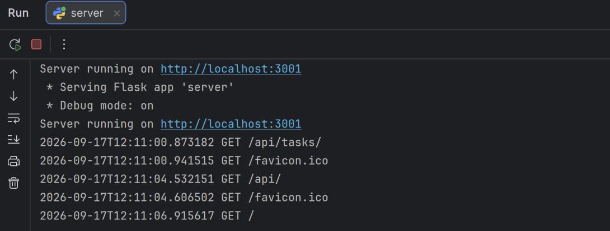

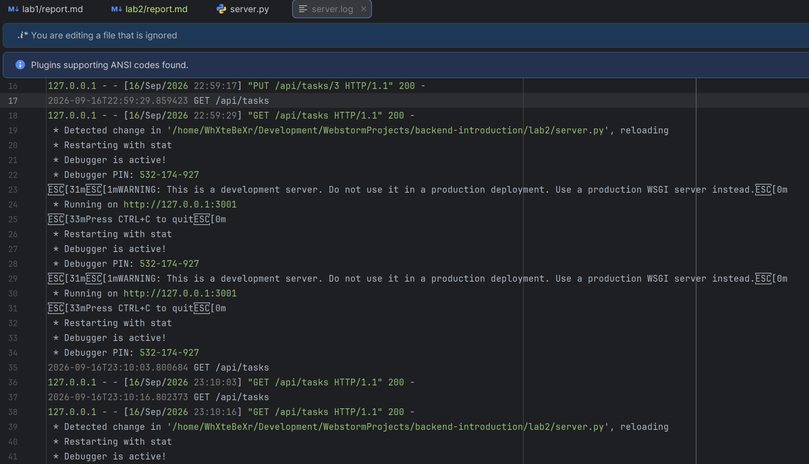

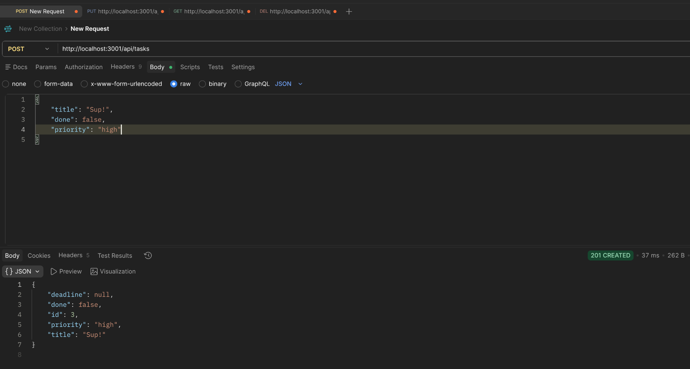

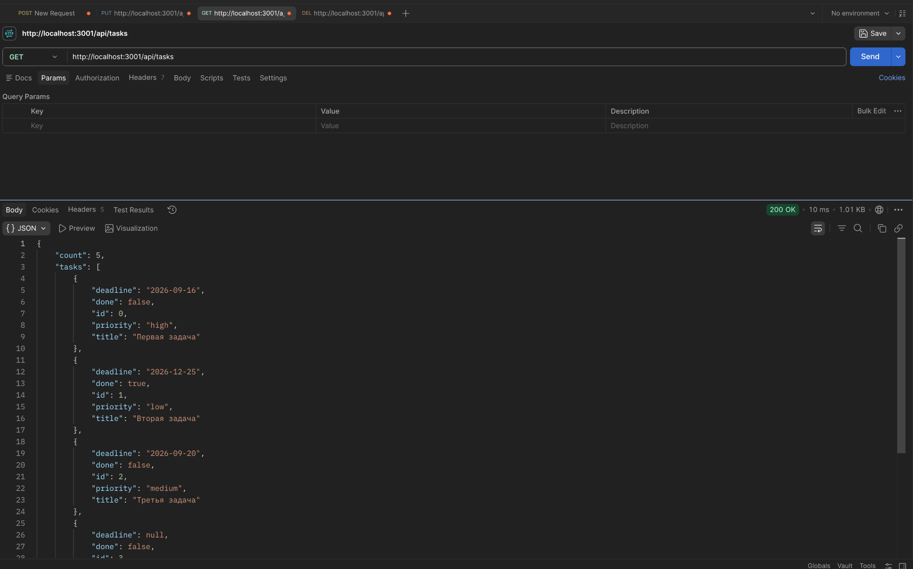

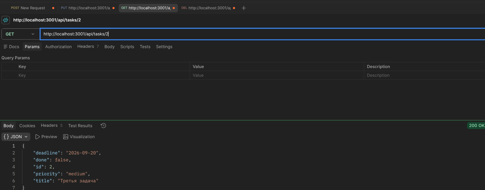

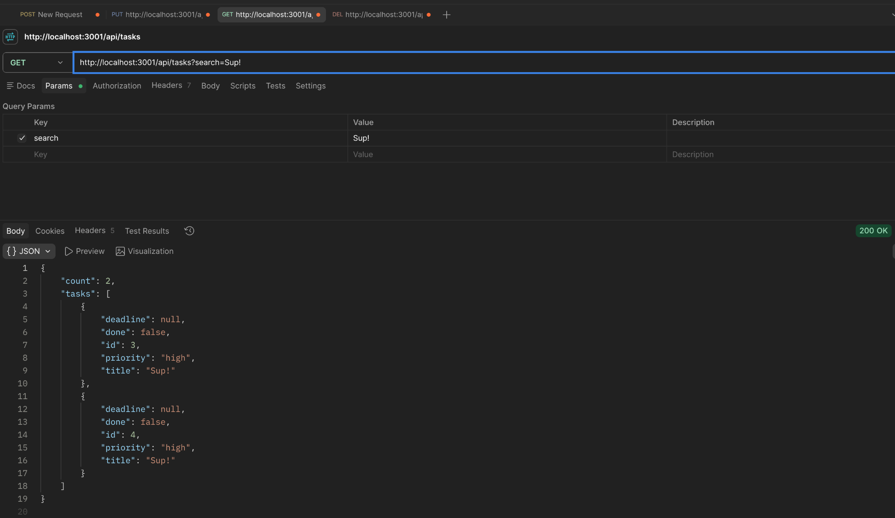

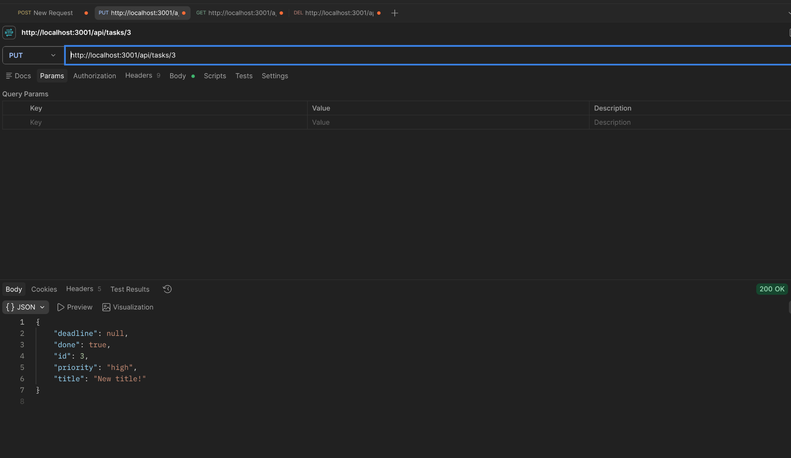

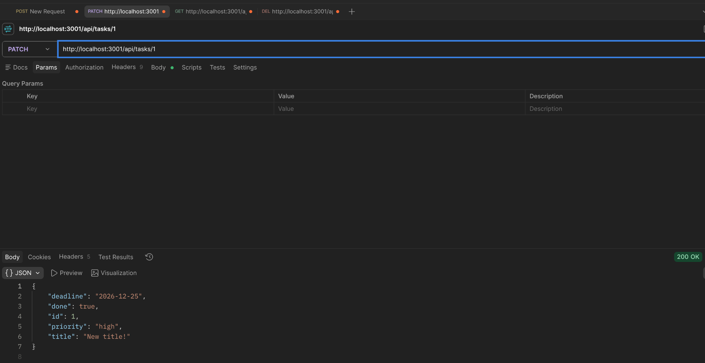

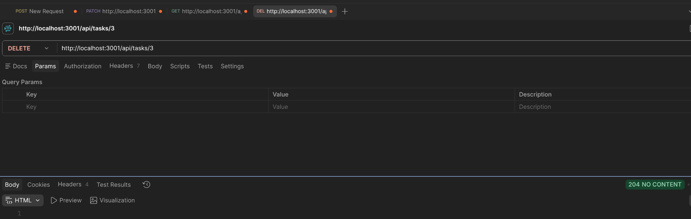

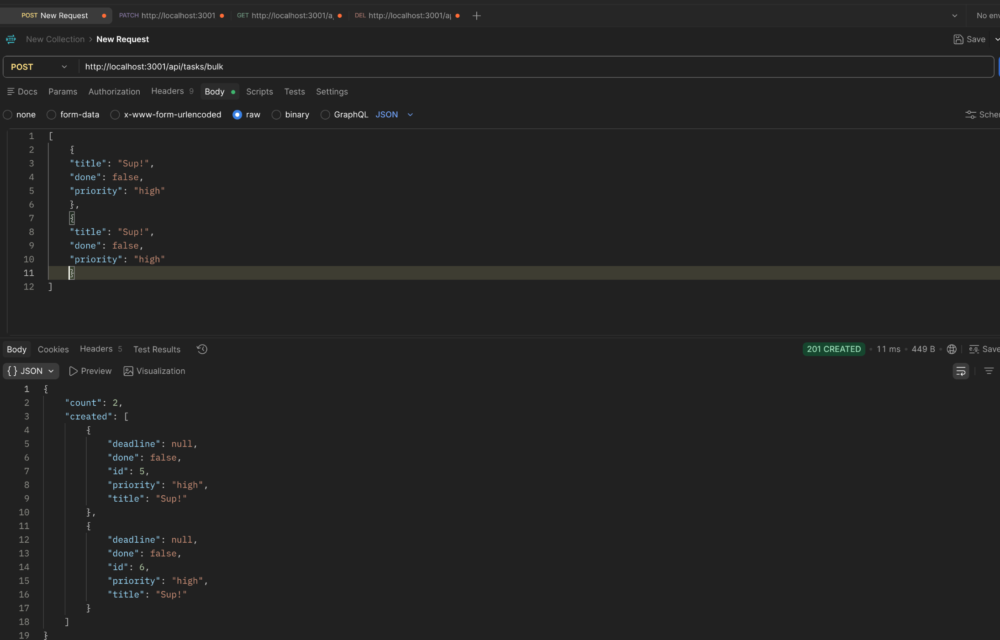

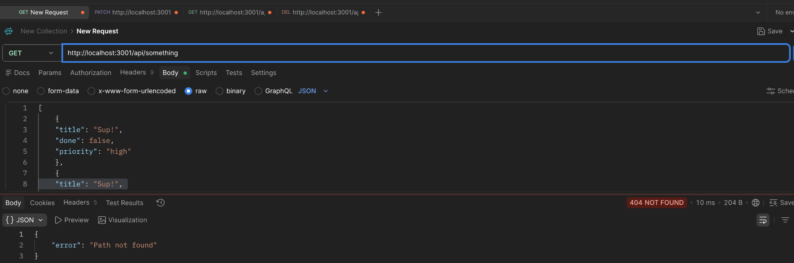

## Контрольные вопросы

### 1. Что такое CRUD и какие методы ему соответствуют?

Create создаёт ресурс методом POST, Read читает его методом GET, Update изменяет посредством PUT или PATCH, Delete удаляет методом DELETE.

### 2. В чём разница между PUT и PATCH?

В реализации PUT требует title и заменяет все изменяемые поля, применяя значения по умолчанию к пропущенным полям. PATCH изменяет только переданные поля. В обоих случаях ID сохраняется.

### 3. Как реализовать частичное обновление?

Найти задачу по ID, проверить JSON с разрешёнными для PATCH правилами и присвоить значения только тем полям, которые присутствуют в запросе. Если задача отсутствует, вернуть 404.

### 4. Как реализовать массовое удаление?

Очистить список задач и вернуть пустое тело со статусом 204. Сохранение счётчика ID позволяет продолжить последовательность идентификаторов при последующем создании.

### 5. Как реализовать массовое создание?

Принять JSON-массив и проверить все элементы. После успешной проверки создать задачи с отдельными ID и вернуть массив созданных объектов со статусом 201. Предварительная проверка предотвращает добавление части ошибочного пакета.

### 6. Как реализовать глобальный обработчик ошибок?

Зарегистрировать обработчик через app.errorhandler. Для HTTPException сохранить предусмотренные HTTP-статус и заголовки. Для остальных исключений записать подробности в журнал сервера и вернуть JSON со статусом 500.

### 7. Как логировать запросы в файл?

Создать FileHandler из модуля logging и подключить его к журналу. В функции с декоратором app.before_request записывать время, HTTP-метод и URL. В работе используется файл access.log.

### 8. Что такое REST API?

Это интерфейс, построенный вокруг ресурсов с адресами и единообразными HTTP-операциями. Клиент передаёт данные запроса, сервер выполняет операцию и возвращает представление результата со статусом. Отсутствие состояния клиентского сеанса между запросами позволяет обрабатывать каждый запрос самостоятельно.

### 9. Как избежать повторения ID?

Использовать отдельный возрастающий счётчик. Первое свободное значение вычисляется по максимальному исходному ID. После создания счётчик увеличивается, после удаления сохраняет значение.

### 10. Как реализованы связи между задачами?

Связь определяется совпадением priority. Обработчик related находит исходную задачу и выбирает другие записи с таким же приоритетом. Исходная задача в ответ не включается.

### 11. Как реализованы поиск, сортировка и пагинация?

Поиск проверяет вхождение search в название без учёта регистра. Сортировка использует поле sort и направление order. Пагинация берёт срез списка с индексами от (page − 1) × limit до page × limit.

### 12. Что происходит с данными при перезапуске?

Изменения коллекции теряются, поскольку данные находятся в оперативной памяти. Следующий запуск создаёт исходные три задачи и восстанавливает начальное значение счётчика.

## Вывод

Разработан API задач на Python и Flask для варианта 1 повышенного уровня. Реализованы CRUD, частичное обновление, поиск, сортировка, пагинация, массовые операции, статистика и подбор задач по приоритету. Освоены проверка входных данных, выбор HTTP-статусов, запись запросов в журнал и обработка ошибок. Примеры запросов показывают создание и изменение задач, получение статистики, очистку коллекции и ответы при неверных данных.
