# Отчет по лабораторной работе 3

МИНИСТЕРСТВО НАУКИ И ВЫСШЕГО ОБРАЗОВАНИЯ
РОССИЙСКОЙ ФЕДЕРАЦИИ
Федеральное государственное автономное
образовательное учреждение высшего образования
«СЕВЕРО-КАВКАЗСКИЙ ФЕДЕРАЛЬНЫЙ УНИВЕРСИТЕТ»
Институт информационных технологий и кибер безопасности
Департамент цифровых, робототехнических систем и электроники
Кафедра программной инженерии

**Тема** - Маршрутизация, параметры пути и query-параметры

**Вариант** - 3, повышенный (продвинутый) уровень

**Выполнил:**
Студент группы ПИЖ-б-о-25-2 (2),
направление подготовки: 09.03.04
“Программная инженерия”
Кравцун Михаил Алексеевич

**Проверил:**
Заведующая МИБК
Новикова Елена Николаевна


---

## Репозиторий

[GitHub - лабораторная работа № 3](https://github.com/WhXteBeXr/backend-introduction/tree/main/lab3)

## Цель работы

Освоить маршрутизацию во Flask, передачу параметров через URL, обработку вложенных ресурсов и валидацию входных параметров. Реализовать API товаров с поиском, фильтрацией, сортировкой и пагинацией.

## Постановка задачи

Выполнить вариант 3 повышенного уровня с требованиями базового и среднего уровней. Основная сущность - товары, связанная сущность - бренды. Каждый товар относится к категории и бренду, отзывы принадлежат товарам.

| Уровень | Требования |
| --- | --- |
| Базовый | Список товаров, товар по ID, отзывы товара, товары категории. Ответы 400 и 404, автоматический перезапуск |
| Средний | Поиск по названию, сортировка по id, name, price, stock, фильтрация по category и price, пагинация с метаданными |
| Продвинутый | Вложенные маршруты категорий и брендов, несколько параметров пути, статистика цен, связи по категории, обработка неизвестного пути, консольный журнал времени, метода, URL и IP, обработчик 500 |

## Теоретическая часть

Маршрутизация сопоставляет HTTP-метод и путь запроса с функцией-обработчиком. Во Flask маршрут регистрируется декоратором. Статический адрес /products/stats возвращает статистику, динамический /products/<product_id> получает конкретный товар. Flask учитывает специфичность правил при выборе маршрута.

Параметры пути определяют ресурс или его положение в иерархии. Query-параметры после знака вопроса задают поиск, фильтры и вид выборки. Например, /brands/1/products?sort=price выбирает товары бренда 1 и упорядочивает их по цене. Тело запроса передаётся отдельно и обычно применяется при создании и изменении данных. В этой работе используются GET-запросы.

Вложенный маршрут отражает принадлежность ресурсов. Для получения отзыва по пути бренда проверяется существование бренда, товара и отзыва, а также связи между ними. Входные параметры проверяются до формирования ответа. Неверное значение параметра приводит к 400, отсутствие ресурса или связи - к 404.

## Исходные файлы

[server.py](server.py) содержит данные и маршруты Flask. Функция collection_response реализует общий алгоритм выборки товаров, find_record выполняет поиск по идентификатору, brand_product проверяет связь бренда и товара. Все данные находятся в оперативной памяти процесса.

## Существенные детали

- ID - положительное целое число. Поиск выполняется по значению id, независимо от позиции в списке.
- Один товар относится к одному бренду и одной категории. Отзыв связан с товаром через product_id.
- Поиск и фильтры применяются до сортировки и пагинации.
- Повторяющиеся filter объединяются условием И. Повторение остальных параметров списка отклоняется.
- Поле count содержит число записей во всей отфильтрованной выборке. totalPages вычисляется до выделения страницы.
- GET не изменяет коллекции. Пустая выборка возвращается со статусом 200.
- Глобальный обработчик сохраняет статусы HTTP-ошибок и возвращает JSON. Неожиданное исключение получает статус 500.
- Запросы, включая ошибочные, выводятся в консоль с временем, HTTP-методом, URL и IP-адресом клиента.

## Запуск

В окружении Python с установленным Flask из корня репозитория выполняется команда

```bash
python lab3/server.py
```

Базовый адрес - `http://localhost:8080`. Режим debug=True обеспечивает автоматический перезапуск при изменении исходника.

## Описание API

### Данные

| Сущность | Поля |
| --- | --- |
| Товар | id - идентификатор, name - название, price - цена, stock - остаток в единицах, category - категория, brand_id - ID бренда |
| Бренд | id - идентификатор, name - название |
| Отзыв | id - идентификатор, product_id - ID товара, author - автор, text - текст |

Начальные категории - food и toys. Бренды - PetCare с ID 1 и HappyPet с ID 2. В коллекции четыре товара и три отзыва. Цены представлены числами в рублях, остаток - целым числом единиц товара.

### Маршруты

Все маршруты принимают GET. Ответы, в том числе ошибки, имеют Content-Type application/json.

| Путь | Назначение |
| --- | --- |
| /products | Список товаров с параметрами выборки |
| /products/<product_id> | Товар по ID |
| /products/<product_id>/reviews | Все отзывы товара |
| /categories/<category>/products | Товары категории с параметрами выборки |
| /categories/<category>/products/<product_id> | Товар внутри категории |
| /brands | Список брендов |
| /brands/<brand_id>/products | Товары бренда с параметрами выборки |
| /brands/<brand_id>/products/<product_id> | Товар внутри бренда |
| /brands/<brand_id>/products/<product_id>/reviews/<review_id> | Отзыв товара указанного бренда |
| /products/<product_id>/related | Другие товары той же категории |
| /products/stats | Количество товаров, средняя, минимальная и максимальная цена |

category задаётся строкой food или toys. product_id, brand_id и review_id должны быть положительными целыми числами, записанными десятичными цифрами ASCII. Предельная длина числового параметра - 10 цифр.

### Query-параметры списков товаров

Параметры поддерживаются в /products, /categories/<category>/products и /brands/<brand_id>/products. Они применяются внутри выбранной коллекции.

| Параметр | Формат | Значение по умолчанию и правила |
| --- | --- | --- |
| search | Строка до 100 символов | Пустая строка. Поиск подстроки в name без учёта регистра |
| sort | id, name, price, stock | id. Одно поле сортировки |
| order | asc или desc | asc |
| page | Положительное целое | 1 |
| limit | Целое от 1 до 100 | 10 |
| filter | category:значение или price:число | Фильтрация не применяется. Несколько filter разрешены |

Фильтрация по category использует точное совпадение строки. Фильтрация по price использует числовое равенство, цена должна быть конечной и неотрицательной. Неизвестные query-параметры списка возвращают 400. page и limit можно передавать независимо, отсутствующий получает значение по умолчанию.

Ответ списка содержит count, page, limit, totalPages и items. Количество страниц вычисляется как (count + limit − 1) // limit. Для пустой выборки count и totalPages равны 0. Для страницы за пределами выборки items пуст, а count продолжает показывать общее число совпадений.

### Правила ответов

| Статус | Условие |
| --- | --- |
| 200 OK | Успешный GET, включая пустые списки |
| 400 Bad Request | Неверный ID или query-параметр списка |
| 404 Not Found | Нет ресурса, категории, связи или маршрута |
| 405 Method Not Allowed | Метод не поддерживается маршрутом |
| 500 Internal Server Error | Непредвиденное исключение |

Ошибки возвращаются объектом с полем error. Нечисловой ID возвращает 400, поскольку параметры пути принимаются как строки и проверяются обработчиком. Для неизвестной категории возвращается 404. Совпадение ID товара с существующим товаром другой категории или бренда также возвращает 404.

## Результаты выполнения

Запросы выполнены для исходной коллекции. Далее приведены адреса, статусы и JSON-ответы сервера. Для каждого запроса сохранён снимок ответа в браузере.


### 1. Список товаров

Параметры не переданы, используются первая страница, limit=10 и сортировка по ID.

```http
GET /products HTTP/1.1
Host: localhost:8080
```

Ответ сервера - 200 OK.

```json
{
  "count": 4,
  "items": [
    {
      "brand_id": 1,
      "category": "food",
      "id": 1,
      "name": "Корм для кошек",
      "price": 400,
      "stock": 12
    },
    {
      "brand_id": 2,
      "category": "food",
      "id": 2,
      "name": "Корм для собак",
      "price": 1200,
      "stock": 8
    },
    {
      "brand_id": 1,
      "category": "toys",
      "id": 3,
      "name": "Мяч для кошки",
      "price": 300,
      "stock": 0
    },
    {
      "brand_id": 2,
      "category": "toys",
      "id": 4,
      "name": "Игрушка для собаки",
      "price": 600,
      "stock": 5
    }
  ],
  "limit": 10,
  "page": 1,
  "totalPages": 1
}
```

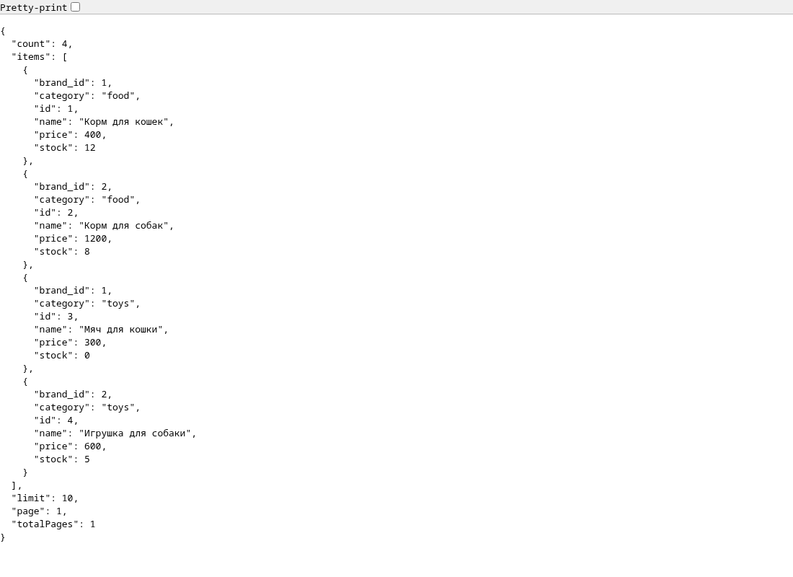


### 2. Товар по ID

Возвращается товар с ID 1.

```http
GET /products/1 HTTP/1.1
Host: localhost:8080
```

Ответ сервера - 200 OK.

```json
{
  "product": {
    "brand_id": 1,
    "category": "food",
    "id": 1,
    "name": "Корм для кошек",
    "price": 400,
    "stock": 12
  }
}
```

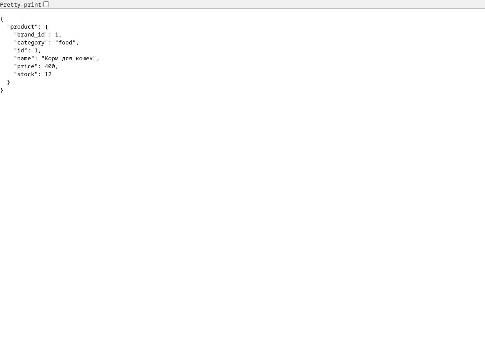


### 3. Отзывы товара

У товара 1 два отзыва. Для товара без отзывов reviews содержит пустой массив.

```http
GET /products/1/reviews HTTP/1.1
Host: localhost:8080
```

Ответ сервера - 200 OK.

```json
{
  "count": 2,
  "reviews": [
    {
      "author": "Анна",
      "id": 1,
      "product_id": 1,
      "text": "Кошке понравился корм"
    },
    {
      "author": "Иван",
      "id": 2,
      "product_id": 1,
      "text": "Удобная упаковка"
    }
  ]
}
```

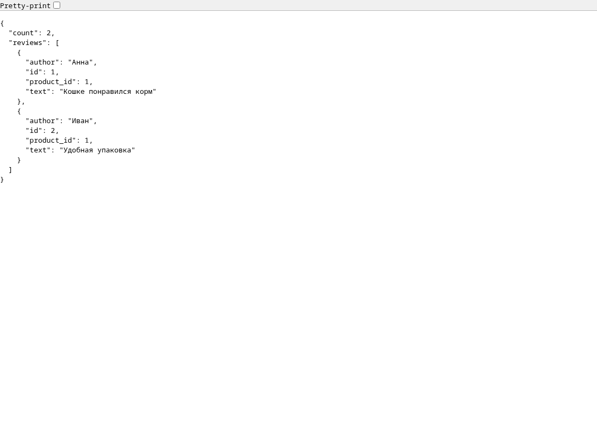


### 4. Товары категории

Категория food содержит два товара. Параметры выборки работают внутри этой категории.

```http
GET /categories/food/products HTTP/1.1
Host: localhost:8080
```

Ответ сервера - 200 OK.

```json
{
  "count": 2,
  "items": [
    {
      "brand_id": 1,
      "category": "food",
      "id": 1,
      "name": "Корм для кошек",
      "price": 400,
      "stock": 12
    },
    {
      "brand_id": 2,
      "category": "food",
      "id": 2,
      "name": "Корм для собак",
      "price": 1200,
      "stock": 8
    }
  ],
  "limit": 10,
  "page": 1,
  "totalPages": 1
}
```

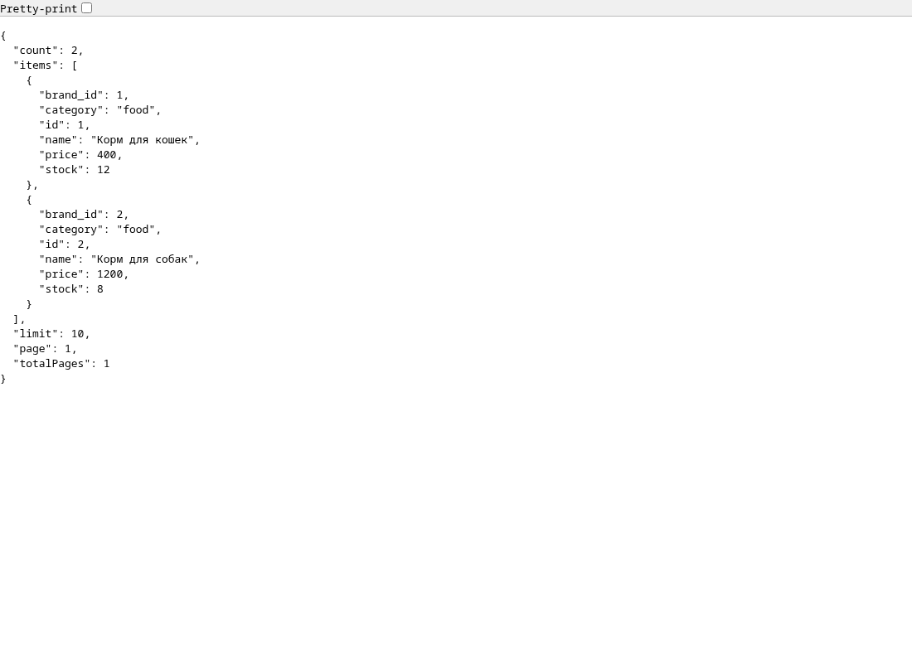


### 5. Товар внутри категории

Товар 1 принадлежит категории food.

```http
GET /categories/food/products/1 HTTP/1.1
Host: localhost:8080
```

Ответ сервера - 200 OK.

```json
{
  "category": "food",
  "product": {
    "brand_id": 1,
    "category": "food",
    "id": 1,
    "name": "Корм для кошек",
    "price": 400,
    "stock": 12
  }
}
```

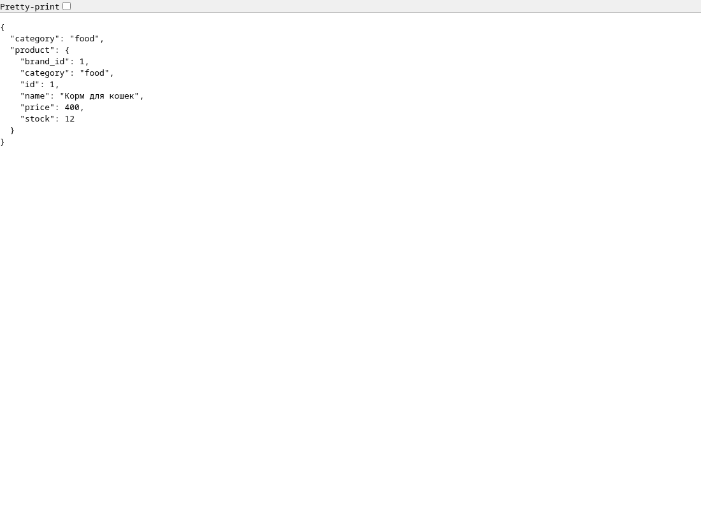


### 6. Бренды

Возвращаются обе записи брендов.

```http
GET /brands HTTP/1.1
Host: localhost:8080
```

Ответ сервера - 200 OK.

```json
{
  "brands": [
    {
      "id": 1,
      "name": "PetCare"
    },
    {
      "id": 2,
      "name": "HappyPet"
    }
  ],
  "count": 2
}
```

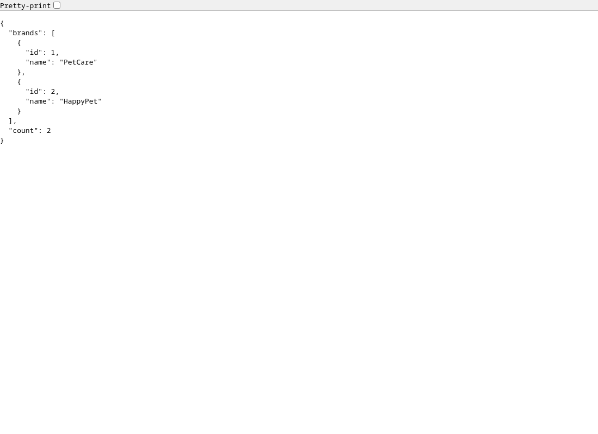


### 7. Товары бренда

Бренду 1 принадлежат товары 1 и 3.

```http
GET /brands/1/products HTTP/1.1
Host: localhost:8080
```

Ответ сервера - 200 OK.

```json
{
  "count": 2,
  "items": [
    {
      "brand_id": 1,
      "category": "food",
      "id": 1,
      "name": "Корм для кошек",
      "price": 400,
      "stock": 12
    },
    {
      "brand_id": 1,
      "category": "toys",
      "id": 3,
      "name": "Мяч для кошки",
      "price": 300,
      "stock": 0
    }
  ],
  "limit": 10,
  "page": 1,
  "totalPages": 1
}
```

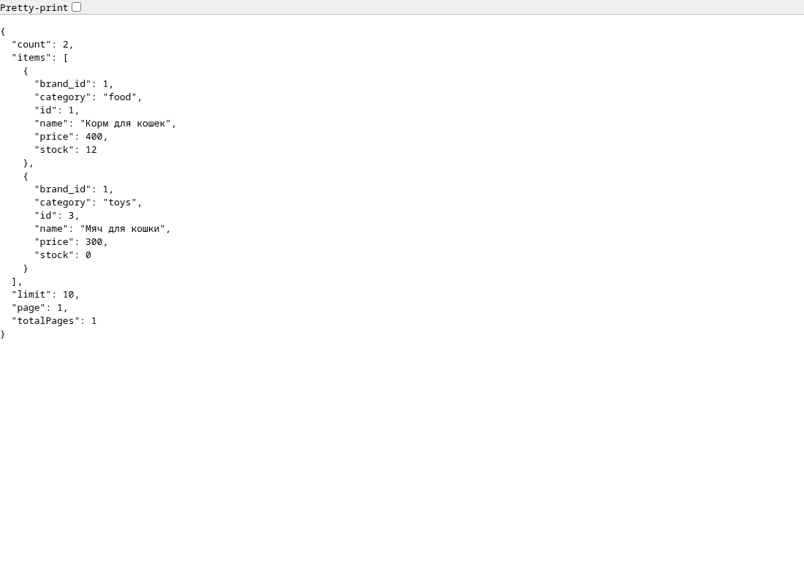


### 8. Товар внутри бренда

Возвращаются бренд и принадлежащий ему товар.

```http
GET /brands/1/products/1 HTTP/1.1
Host: localhost:8080
```

Ответ сервера - 200 OK.

```json
{
  "brand": {
    "id": 1,
    "name": "PetCare"
  },
  "product": {
    "brand_id": 1,
    "category": "food",
    "id": 1,
    "name": "Корм для кошек",
    "price": 400,
    "stock": 12
  }
}
```

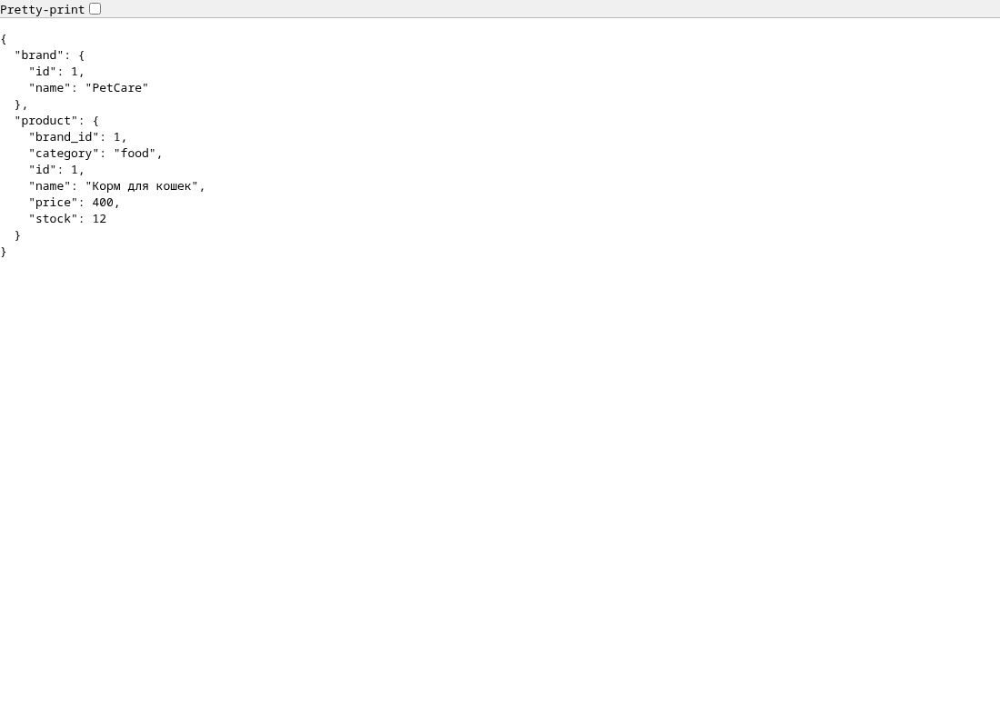


### 9. Отзыв товара бренда

Проверяются все три ID и обе связи. Отзыв 2 принадлежит товару 1 бренда 1.

```http
GET /brands/1/products/1/reviews/2 HTTP/1.1
Host: localhost:8080
```

Ответ сервера - 200 OK.

```json
{
  "brand": {
    "id": 1,
    "name": "PetCare"
  },
  "product": {
    "brand_id": 1,
    "category": "food",
    "id": 1,
    "name": "Корм для кошек",
    "price": 400,
    "stock": 12
  },
  "review": {
    "author": "Иван",
    "id": 2,
    "product_id": 1,
    "text": "Удобная упаковка"
  }
}
```

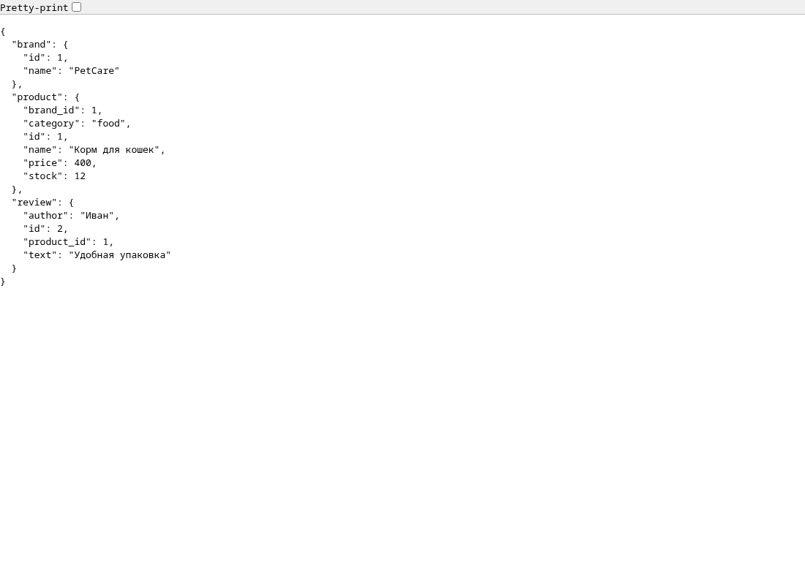


### 10. Связанные товары

Товар 2 относится к той же категории food. Исходный товар исключён.

```http
GET /products/1/related HTTP/1.1
Host: localhost:8080
```

Ответ сервера - 200 OK.

```json
{
  "count": 1,
  "items": [
    {
      "brand_id": 2,
      "category": "food",
      "id": 2,
      "name": "Корм для собак",
      "price": 1200,
      "stock": 8
    }
  ]
}
```

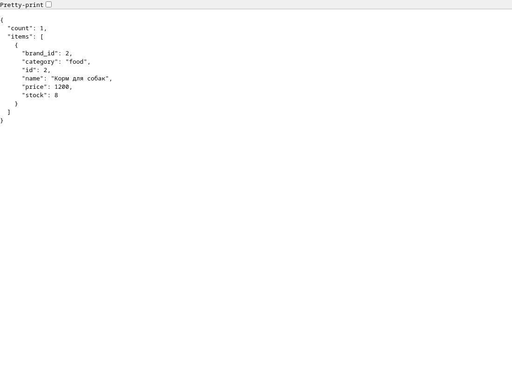


### 11. Статистика

Средняя цена равна (400 + 1200 + 300 + 600) / 4 = 625. Для пустой коллекции count равен 0, показатели цены равны null.

```http
GET /products/stats HTTP/1.1
Host: localhost:8080
```

Ответ сервера - 200 OK.

```json
{
  "average_price": 625.0,
  "count": 4,
  "max_price": 1200,
  "min_price": 300
}
```

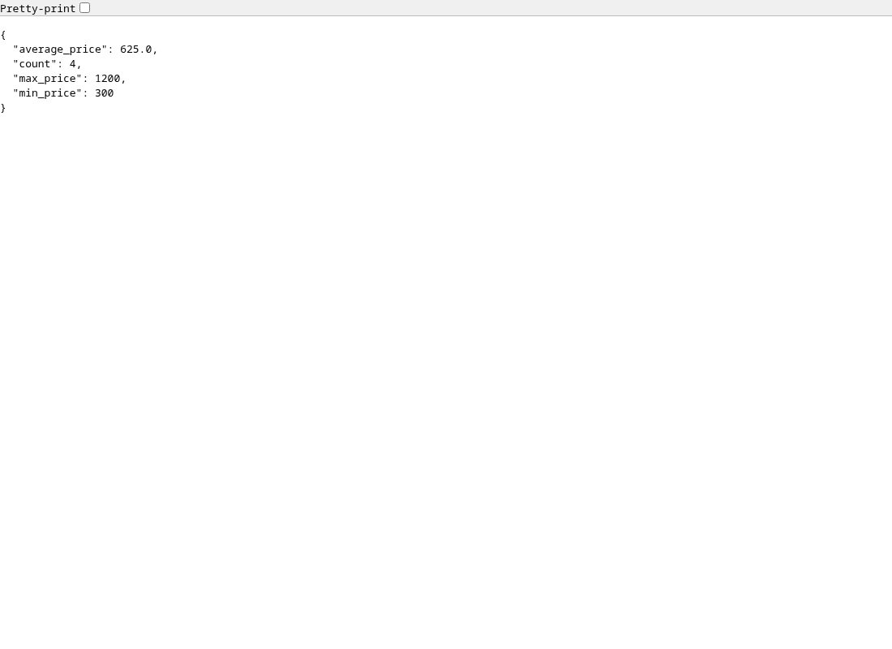


### 12. Комбинация поиска, сортировки и пагинации

Поиск находит два корма. При убывании цены на второй странице оказывается корм для кошек.

```http
GET /products?search=корм&sort=price&order=desc&page=2&limit=1 HTTP/1.1
Host: localhost:8080
```

Ответ сервера - 200 OK.

```json
{
  "count": 2,
  "items": [
    {
      "brand_id": 1,
      "category": "food",
      "id": 1,
      "name": "Корм для кошек",
      "price": 400,
      "stock": 12
    }
  ],
  "limit": 1,
  "page": 2,
  "totalPages": 2
}
```


### 13. Фильтрация по нескольким полям

Оба фильтра должны выполняться одновременно. Выбирается товар категории food с ценой 400.

```http
GET /products?filter=category:food&filter=price:400 HTTP/1.1
Host: localhost:8080
```

Ответ сервера - 200 OK.

```json
{
  "count": 1,
  "items": [
    {
      "brand_id": 1,
      "category": "food",
      "id": 1,
      "name": "Корм для кошек",
      "price": 400,
      "stock": 12
    }
  ],
  "limit": 10,
  "page": 1,
  "totalPages": 1
}
```

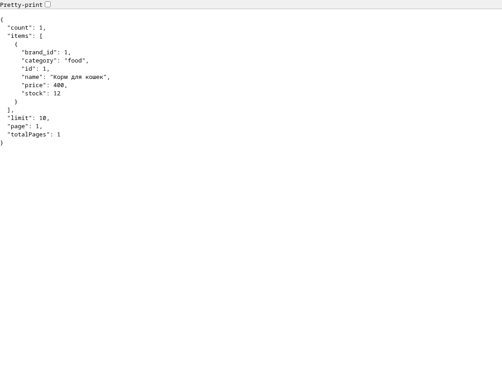


### 14. Ошибка параметров или отсутствующий ресурс

Сервер возвращает статус ошибки и сообщение в поле error.

```http
GET /products/abc HTTP/1.1
Host: localhost:8080
```

Ответ сервера - 400 BAD REQUEST.

```json
{
  "error": "product_id must be a positive integer"
}
```

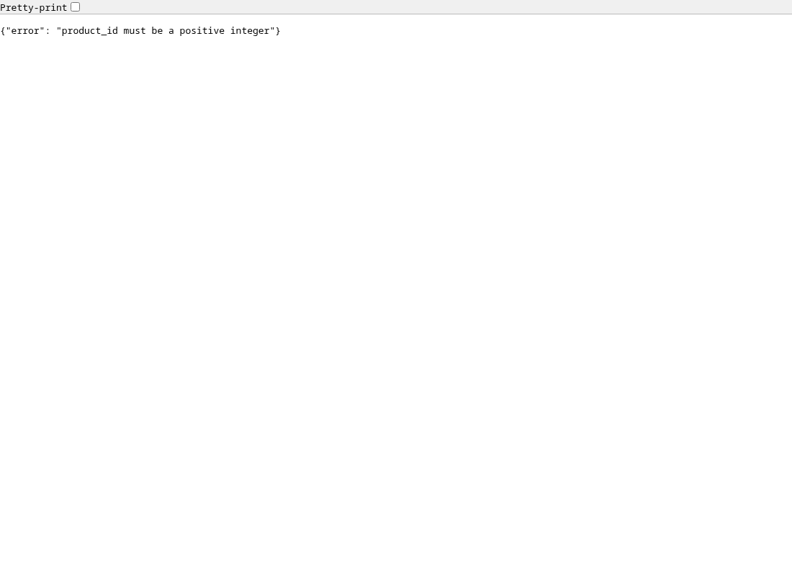


### 15. Ошибка параметров или отсутствующий ресурс

Сервер возвращает статус ошибки и сообщение в поле error.

```http
GET /products/0 HTTP/1.1
Host: localhost:8080
```

Ответ сервера - 400 BAD REQUEST.

```json
{
  "error": "product_id must be a positive integer"
}
```


### 16. Ошибка параметров или отсутствующий ресурс

Сервер возвращает статус ошибки и сообщение в поле error.

```http
GET /products/-1 HTTP/1.1
Host: localhost:8080
```

Ответ сервера - 400 BAD REQUEST.

```json
{
  "error": "product_id must be a positive integer"
}
```


### 17. Ошибка параметров или отсутствующий ресурс

Сервер возвращает статус ошибки и сообщение в поле error.

```http
GET /products/999 HTTP/1.1
Host: localhost:8080
```

Ответ сервера - 404 NOT FOUND.

```json
{
  "error": "Product not found"
}
```


### 18. Ошибка параметров или отсутствующий ресурс

Сервер возвращает статус ошибки и сообщение в поле error.

```http
GET /categories/missing/products HTTP/1.1
Host: localhost:8080
```

Ответ сервера - 404 NOT FOUND.

```json
{
  "error": "Category not found"
}
```


### 19. Ошибка параметров или отсутствующий ресурс

Сервер возвращает статус ошибки и сообщение в поле error.

```http
GET /categories/food/products/3 HTTP/1.1
Host: localhost:8080
```

Ответ сервера - 404 NOT FOUND.

```json
{
  "error": "Product not found"
}
```


### 20. Ошибка параметров или отсутствующий ресурс

Сервер возвращает статус ошибки и сообщение в поле error.

```http
GET /brands/1/products/2 HTTP/1.1
Host: localhost:8080
```

Ответ сервера - 404 NOT FOUND.

```json
{
  "error": "Product not found in this brand"
}
```

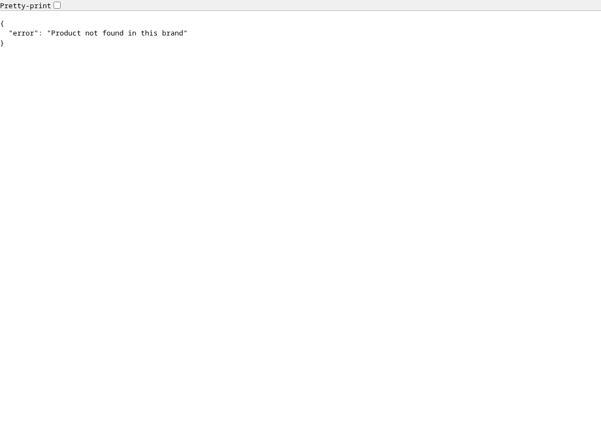


### 21. Ошибка параметров или отсутствующий ресурс

Сервер возвращает статус ошибки и сообщение в поле error.

```http
GET /brands/1/products/1/reviews/3 HTTP/1.1
Host: localhost:8080
```

Ответ сервера - 404 NOT FOUND.

```json
{
  "error": "Review not found for this product"
}
```

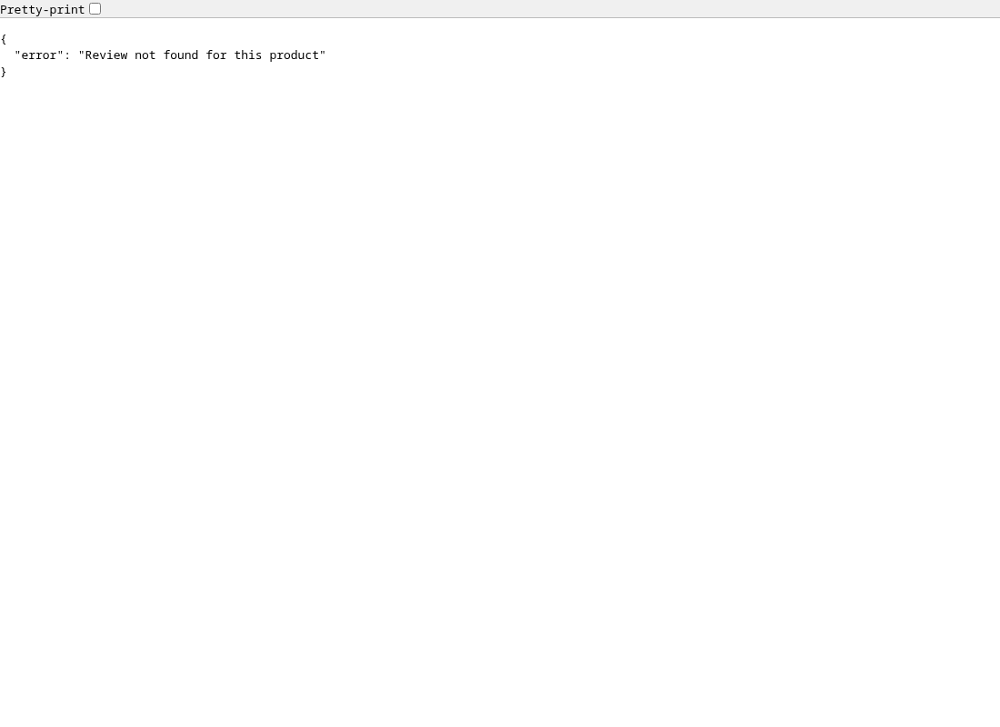


### 22. Ошибка параметров или отсутствующий ресурс

Сервер возвращает статус ошибки и сообщение в поле error.

```http
GET /products?sort=category HTTP/1.1
Host: localhost:8080
```

Ответ сервера - 400 BAD REQUEST.

```json
{
  "error": "sort must be id, name, price or stock"
}
```

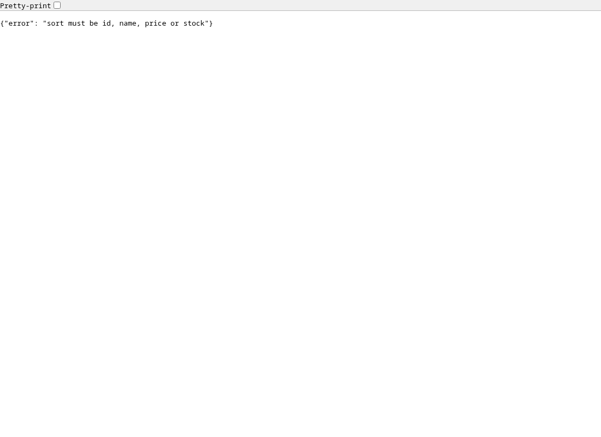


### 23. Ошибка параметров или отсутствующий ресурс

Сервер возвращает статус ошибки и сообщение в поле error.

```http
GET /products?order=up HTTP/1.1
Host: localhost:8080
```

Ответ сервера - 400 BAD REQUEST.

```json
{
  "error": "order must be asc or desc"
}
```


### 24. Ошибка параметров или отсутствующий ресурс

Сервер возвращает статус ошибки и сообщение в поле error.

```http
GET /products?page=no HTTP/1.1
Host: localhost:8080
```

Ответ сервера - 400 BAD REQUEST.

```json
{
  "error": "page must be a positive integer"
}
```

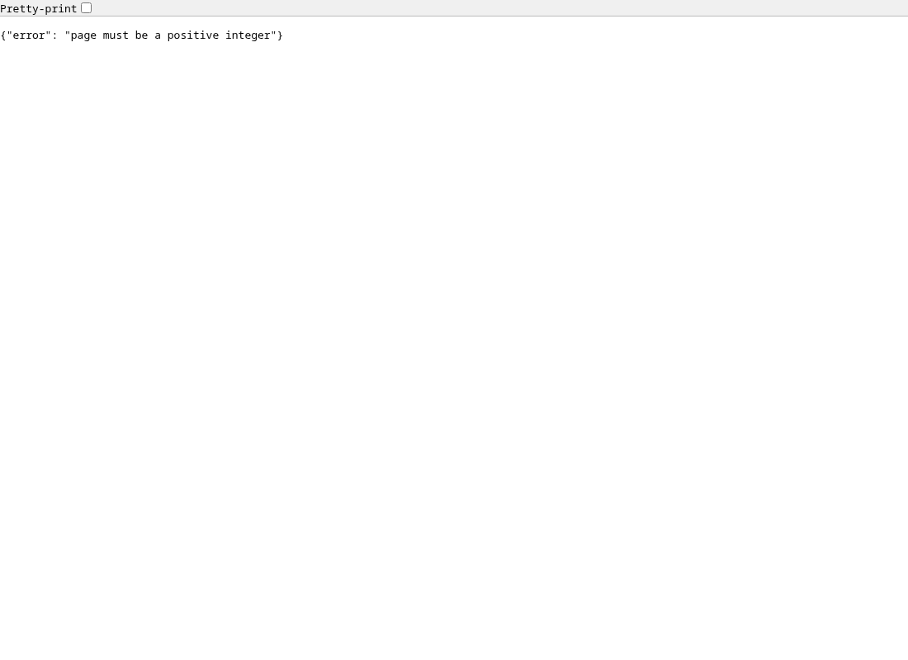


### 25. Ошибка параметров или отсутствующий ресурс

Сервер возвращает статус ошибки и сообщение в поле error.

```http
GET /products?limit=101 HTTP/1.1
Host: localhost:8080
```

Ответ сервера - 400 BAD REQUEST.

```json
{
  "error": "limit must be between 1 and 100"
}
```


### 26. Ошибка параметров или отсутствующий ресурс

Сервер возвращает статус ошибки и сообщение в поле error.

```http
GET /products?filter=stock:1 HTTP/1.1
Host: localhost:8080
```

Ответ сервера - 400 BAD REQUEST.

```json
{
  "error": "filter must be category:value or price:value"
}
```

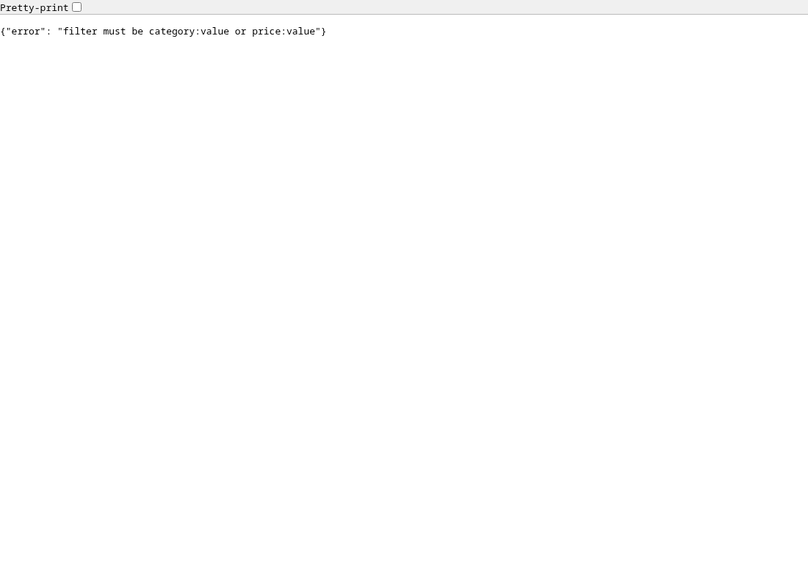


### 27. Ошибка параметров или отсутствующий ресурс

Сервер возвращает статус ошибки и сообщение в поле error.

```http
GET /products?filter=price:nan HTTP/1.1
Host: localhost:8080
```

Ответ сервера - 400 BAD REQUEST.

```json
{
  "error": "Filter price must be a finite non-negative number"
}
```


### 28. Ошибка параметров или отсутствующий ресурс

Сервер возвращает статус ошибки и сообщение в поле error.

```http
GET /products?filter=price:-1 HTTP/1.1
Host: localhost:8080
```

Ответ сервера - 400 BAD REQUEST.

```json
{
  "error": "Filter price must be a finite non-negative number"
}
```

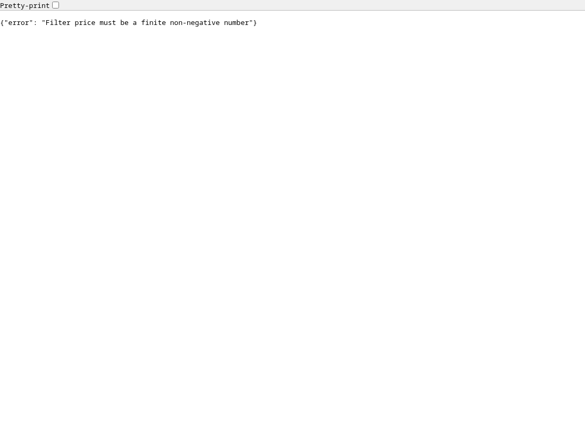


### 29. Ошибка параметров или отсутствующий ресурс

Сервер возвращает статус ошибки и сообщение в поле error.

```http
GET /unknown/path HTTP/1.1
Host: localhost:8080
```

Ответ сервера - 404 NOT FOUND.

```json
{
  "error": "Route not found"
}
```


## Контрольные вопросы

### 1. Как комбинировать параметры пути и query-параметры?

Параметр пути выбирает родительский ресурс, query-параметры уточняют выдачу. В /brands/1/products?sort=price&order=desc сначала выбираются товары бренда 1, затем они сортируются по убыванию цены.

### 2. Как реализовать вложенный маршрут с несколькими уровнями?

Объявить путь с несколькими параметрами и проверить ресурсы по очереди. В маршруте отзыва бренда сначала проверяются бренд и товар, затем соответствие brand_id, существование отзыва и соответствие product_id.

### 3. Как обработать wildcard-маршрут?

Во Flask общий случай отсутствующего пути удобно обработать через app.errorhandler(404). Он формирует JSON вместо стандартной HTML-страницы. В Express общий wildcard помещается после конкретных маршрутов, поскольку там важен порядок регистрации.

### 4. Как реализовать глобальную обработку ошибок?

HTTPException обрабатывается отдельно с сохранением исходного статуса и заголовков. Остальные исключения перехватывает обработчик Exception, который записывает подробности в журнал сервера и возвращает клиенту JSON со статусом 500.

### 5. Как логировать запросы с IP-адресом?

Функция с декоратором app.before_request вызывается перед обработкой запроса. В ней используются datetime.now, request.method, request.full_path и request.remote_addr.

### 6. Как защитить API от больших значений limit?

Проверить целочисленный формат и диапазон от 1 до 100 до получения среза. Значения за пределами диапазона отклоняются со статусом 400.

### 7. Как рассчитать статистику коллекции?

Выделить цены товаров, вычислить их количество, сумму, минимум и максимум. Средняя цена равна сумме, делённой на количество. Для пустой коллекции возвращается null, чтобы избежать деления на ноль и вымышленных цен.

### 8. Как организовать код при росте числа маршрутов?

Общие проверки и формирование выборки вынести в функции. При дальнейшем росте приложения маршруты можно объединять в Blueprint по сущностям, а работу с данными вынести в отдельные модули.

### 9. Как документировать параметры через OpenAPI?

Описать пути, методы, параметры path и query, их типы, обязательность и допустимые значения. Для ответов указать статусы и схемы JSON. Примеры запросов и ответов позволяют воспроизвести сценарии.

### 10. Как тестировать маршруты в Postman?

Задать базовый URL, выбрать GET и подставить ID в адрес. Query-параметры передать через Params. Проверить успешные обращения, неизвестные ID, нечисловые параметры, неверные фильтры и принадлежность вложенных ресурсов.

## Вывод

Создано приложение Flask с маршрутизацией для товаров, категорий, брендов и отзывов. Реализованы параметры пути, вложенные ресурсы, поиск, фильтрация, сортировка, пагинация, статистика цен и подбор по категории. Проверка принадлежности вложенных ресурсов обеспечивает согласованность адресов, а валидация параметров позволяет возвращать понятные сообщения об ошибках. Освоено сочетание параметров пути и query-параметров при построении HTTP API.
