# Отчет по лабораторной работе 4

МИНИСТЕРСТВО НАУКИ И ВЫСШЕГО ОБРАЗОВАНИЯ
РОССИЙСКОЙ ФЕДЕРАЦИИ
Федеральное государственное автономное
образовательное учреждение высшего образования
«СЕВЕРО-КАВКАЗСКИЙ ФЕДЕРАЛЬНЫЙ УНИВЕРСИТЕТ»
Институт информационных технологий и кибер безопасности
Департамент цифровых, робототехнических систем и электроники
Кафедра программной инженерии

**Тема** - Основы SQL. Работа с SQLite

**Вариант** - 3, повышенный (продвинутый) уровень

**Выполнил:**
Студент группы ПИЖ-б-о-25-2 (2),
направление подготовки: 09.03.04
“Программная инженерия”
Кравцун Михаил Алексеевич

**Проверил:**
Заведующая МИБК
Новикова Елена Николаевна


**Технология** - Python, модуль sqlite3

**СУБД** - SQLite

---

## Репозиторий

[GitHub - лабораторная работа № 4](https://github.com/WhXteBeXr/backend-introduction/tree/main/lab4)

## Цель работы

Освоить SQL и SQLite, создание связанных таблиц и выполнение операций с данными. Изучить фильтрацию, сортировку, пагинацию, агрегатные функции, объединения таблиц, подзапросы, транзакции и индексы.

## Постановка задачи

Выполнить вариант 3 повышенного уровня, включая задания базового и среднего уровней. Основная сущность - товары, связанная сущность - категории.

| Уровень | Требования |
| --- | --- |
| Базовый | Таблица products, минимум пять записей, INSERT, SELECT, WHERE, UPDATE и DELETE |
| Средний | Сортировка по name и price, две страницы LIMIT/OFFSET, LIKE, BETWEEN, IN, COUNT, SUM, AVG, MIN, MAX, группировка по категории |
| Продвинутый | Таблица categories, FOREIGN KEY, INNER JOIN, LEFT JOIN, GROUP BY с HAVING, подзапрос, BEGIN, COMMIT, ROLLBACK, индекс и отдельный init_db.sql |

## Теоретическая часть

SQL - декларативный язык работы с реляционными данными. CREATE TABLE определяет структуру таблицы, INSERT добавляет строки, SELECT получает данные, UPDATE изменяет значения, DELETE удаляет записи. WHERE отбирает строки, ORDER BY задаёт порядок, LIMIT и OFFSET ограничивают выдачу. Агрегатные функции вычисляют показатели по всей выборке или отдельным группам GROUP BY.

SQLite - встроенная СУБД, хранящая базу в файле. Для работы из Python используется стандартный модуль sqlite3. По сравнению со списком в памяти файл базы сохраняет изменения после завершения программы. СУБД также обеспечивает ограничения данных, связи между таблицами и атомарность транзакций.

Внешний ключ связывает товар с категорией. INNER JOIN возвращает совпавшие записи, LEFT JOIN сохраняет строки левой таблицы даже без соответствия справа. Транзакция объединяет изменения в одну операцию, которая завершается COMMIT или отменяется ROLLBACK. Индекс помогает находить строки по ключам без полного перебора таблицы.

## Исходные файлы

[db.py](db.py) открывает базу, применяет начальную миграцию и выполняет демонстрационные SQL-запросы. [init_db.sql](init_db.sql) создаёт таблицы, ограничения, индекс и исходные данные. База lab4.db создаётся в папке лабораторной. [Полный вывод программы](media/program-output.txt) содержит команды и результаты выполнения.

## Схема базы данных

Связь categories.id -> products.category_id имеет тип «один ко многим». Категория может содержать несколько товаров, товар относится к одной категории.

| Таблица | Поле | Тип и ограничения |
| --- | --- | --- |
| categories | id | INTEGER PRIMARY KEY AUTOINCREMENT |
| categories | name | TEXT NOT NULL UNIQUE, непустое название |
| products | id | INTEGER PRIMARY KEY AUTOINCREMENT |
| products | name | TEXT NOT NULL, непустое название |
| products | price | REAL NOT NULL, числовое неотрицательное значение |
| products | stock | INTEGER NOT NULL, целое неотрицательное значение |
| products | category_id | INTEGER NOT NULL, внешний ключ на categories.id |

Удаление используемой категории запрещено правилом ON DELETE RESTRICT. Проверка FOREIGN KEY включается для каждого соединения. Ограничения CHECK проверяют значения на стороне базы.

Начальные категории - «Корм», «Игрушки», «Аксессуары» и «Уход». В каждой из первых трёх категорий по два товара. Категория «Уход» оставлена без товаров для демонстрации LEFT JOIN.

Создан составной индекс idx_products_category_price по category_id и price. Он подходит для отбора по категории с сортировкой по цене внутри неё.

## Существенные детали

- Схема и шесть исходных товаров создаются в одной транзакции. user_version=1 отмечает применённую миграцию.
- При повторном открытии схема и данные сохраняются. Начальное заполнение выполняется один раз.
- Значения запросов передаются через параметры ?, отдельно от текста SQL.
- Страницы выбираются с ORDER BY id, чтобы получить однозначный порядок.
- COUNT(p.id) в LEFT JOIN считает существующие товары. Для категории без товаров результат равен 0.
- Транзакция обновления устанавливает цену товара 1 равной 450 и удаляет товар 6. COMMIT сохраняет изменения.
- Вторая транзакция сначала увеличивает остаток товара 1, затем пытается установить отрицательный остаток товара 2. CHECK отклоняет изменение, ROLLBACK отменяет всю транзакцию.

## Запуск

Дополнительные Python-пакеты не требуются. Из корня репозитория выполняется команда

```bash
python lab4/db.py
```

Для другого файла базы можно указать путь

```bash
python lab4/db.py --db /tmp/lab4-example.db
```

Путь по умолчанию определяется относительно db.py. Команда работает при запуске из другого каталога. Повторный запуск продолжает работу с сохранёнными данными. Товар 6 после первого удаления отсутствует, поэтому следующее удаление затронет 0 строк. Для воспроизведения исходных результатов используется новое имя файла базы.

## Результаты выполнения

Приведён первый запуск с новой базой. Запросы чтения выполнены до изменения данных. В конце демонстрируются подтверждение и отмена транзакций. Снимки представляют форматированный фактический вывод скрипта.


### 1. Создание схемы и начальных данных

Созданы две таблицы, составной индекс и связь по category_id. INSERT добавил четыре категории и шесть товаров. Начальная миграция завершилась COMMIT.

Полный SQL создания и заполнения базы находится в [init_db.sql](init_db.sql).


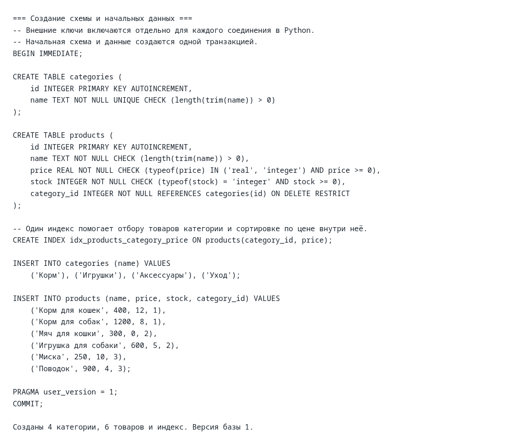


### 2. Схема таблиц и индекс

sqlite_schema содержит определения обеих таблиц и составного индекса. Запрос подтверждает создание схемы и ограничений.


```text
SELECT type, name, sql FROM sqlite_schema WHERE name IN ('categories', 'products', 'idx_products_category_price') ORDER BY type, name
[
  {
    "type": "index",
    "name": "idx_products_category_price",
    "sql": "CREATE INDEX idx_products_category_price ON products(category_id, price)"
  },
  {
    "type": "table",
    "name": "categories",
    "sql": "CREATE TABLE categories (\n    id INTEGER PRIMARY KEY AUTOINCREMENT,\n    name TEXT NOT NULL UNIQUE CHECK (length(trim(name)) > 0)\n)"
  },
  {
    "type": "table",
    "name": "products",
    "sql": "CREATE TABLE products (\n    id INTEGER PRIMARY KEY AUTOINCREMENT,\n    name TEXT NOT NULL CHECK (length(trim(name)) > 0),\n    price REAL NOT NULL CHECK (typeof(price) IN ('real', 'integer') AND price >= 0),\n    stock INTEGER NOT NULL CHECK (typeof(stock) = 'integer' AND stock >= 0),\n    category_id INTEGER NOT NULL REFERENCES categories(id) ON DELETE RESTRICT\n)"
  }
]
```


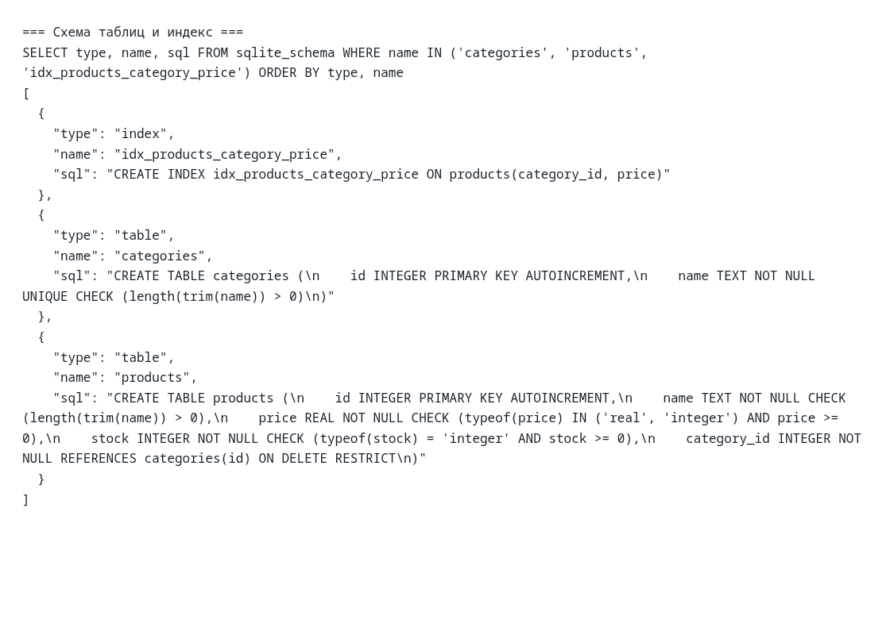


### 3. Список категорий

Выборка четырёх категорий, включая категорию без товаров.


```text
SELECT * FROM categories ORDER BY id
[
  {
    "id": 1,
    "name": "Корм"
  },
  {
    "id": 2,
    "name": "Игрушки"
  },
  {
    "id": 3,
    "name": "Аксессуары"
  },
  {
    "id": 4,
    "name": "Уход"
  }
]
```


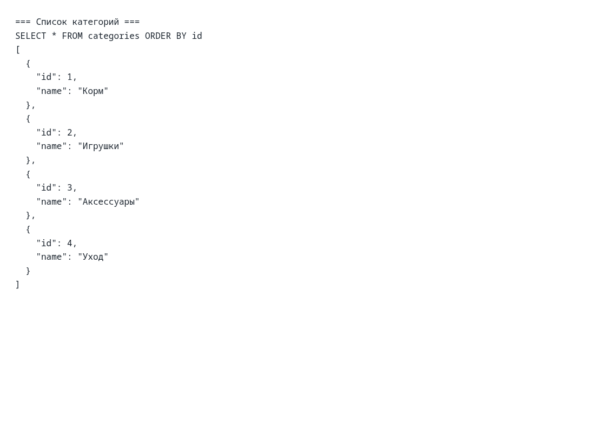


### 4. Список товаров

SELECT * возвращает шесть товаров. Цена, остаток и категория сохранены в отдельных столбцах.


```text
SELECT * FROM products ORDER BY id
[
  {
    "id": 1,
    "name": "Корм для кошек",
    "price": 400.0,
    "stock": 12,
    "category_id": 1
  },
  {
    "id": 2,
    "name": "Корм для собак",
    "price": 1200.0,
    "stock": 8,
    "category_id": 1
  },
  {
    "id": 3,
    "name": "Мяч для кошки",
    "price": 300.0,
    "stock": 0,
    "category_id": 2
  },
  {
    "id": 4,
    "name": "Игрушка для собаки",
    "price": 600.0,
    "stock": 5,
    "category_id": 2
  },
  {
    "id": 5,
    "name": "Миска",
    "price": 250.0,
    "stock": 10,
    "category_id": 3
  },
  {
    "id": 6,
    "name": "Поводок",
    "price": 900.0,
    "stock": 4,
    "category_id": 3
  }
]
```


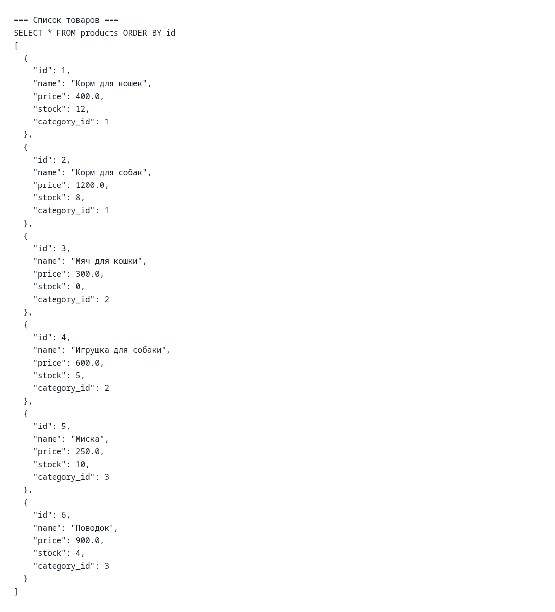


### 5. WHERE: товары в наличии

WHERE stock > 0 оставляет товары в наличии. Товар 3 с нулевым остатком исключается.


```text
SELECT id, name, stock FROM products WHERE stock > ? ORDER BY id
Параметры [0]
[
  {
    "id": 1,
    "name": "Корм для кошек",
    "stock": 12
  },
  {
    "id": 2,
    "name": "Корм для собак",
    "stock": 8
  },
  {
    "id": 4,
    "name": "Игрушка для собаки",
    "stock": 5
  },
  {
    "id": 5,
    "name": "Миска",
    "stock": 10
  },
  {
    "id": 6,
    "name": "Поводок",
    "stock": 4
  }
]
```


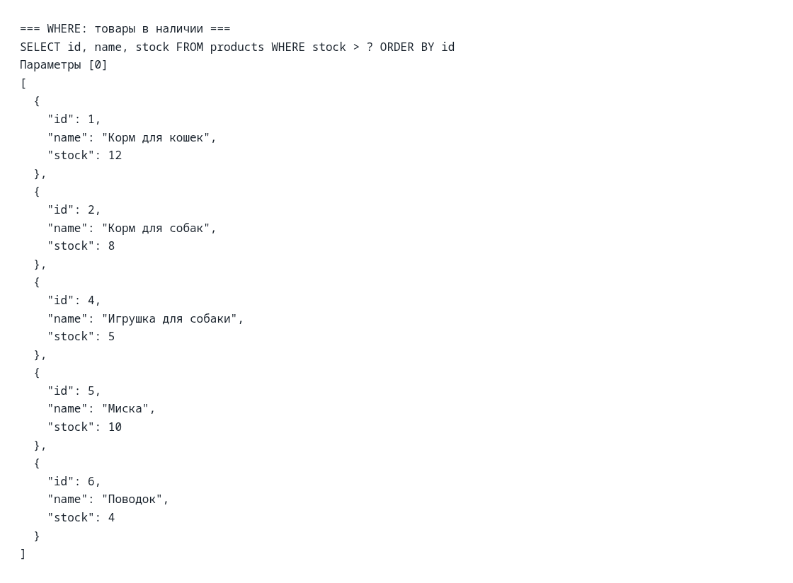


### 6. ORDER BY: название по возрастанию

ORDER BY name ASC упорядочивает названия по возрастанию. id задаёт дополнительный порядок при совпадении названий.


```text
SELECT id, name FROM products ORDER BY name ASC, id ASC
[
  {
    "id": 4,
    "name": "Игрушка для собаки"
  },
  {
    "id": 1,
    "name": "Корм для кошек"
  },
  {
    "id": 2,
    "name": "Корм для собак"
  },
  {
    "id": 5,
    "name": "Миска"
  },
  {
    "id": 3,
    "name": "Мяч для кошки"
  },
  {
    "id": 6,
    "name": "Поводок"
  }
]
```


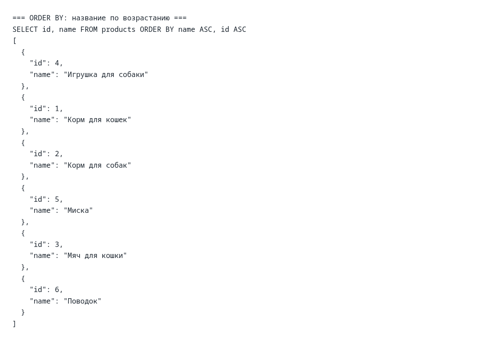


### 7. ORDER BY: цена по убыванию

ORDER BY price DESC располагает товары по убыванию цены.


```text
SELECT id, name, price FROM products ORDER BY price DESC, id ASC
[
  {
    "id": 2,
    "name": "Корм для собак",
    "price": 1200.0
  },
  {
    "id": 6,
    "name": "Поводок",
    "price": 900.0
  },
  {
    "id": 4,
    "name": "Игрушка для собаки",
    "price": 600.0
  },
  {
    "id": 1,
    "name": "Корм для кошек",
    "price": 400.0
  },
  {
    "id": 3,
    "name": "Мяч для кошки",
    "price": 300.0
  },
  {
    "id": 5,
    "name": "Миска",
    "price": 250.0
  }
]
```


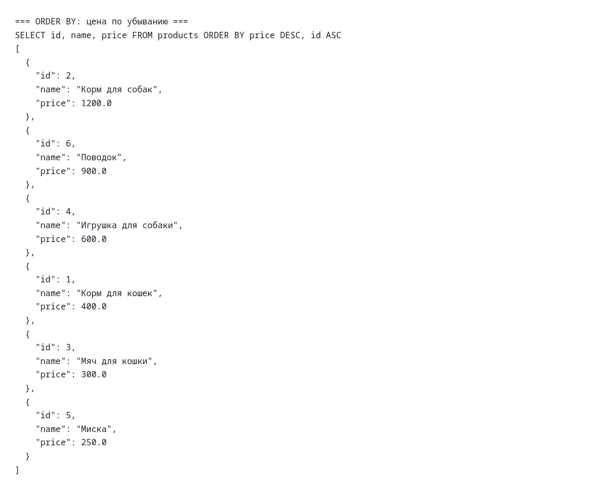


### 8. LIMIT и OFFSET: страница 1

Первая страница содержит три строки. LIMIT равен 3, OFFSET равен 0.


```text
SELECT id, name, price FROM products ORDER BY id LIMIT ? OFFSET ?
Параметры [3, 0]
[
  {
    "id": 1,
    "name": "Корм для кошек",
    "price": 400.0
  },
  {
    "id": 2,
    "name": "Корм для собак",
    "price": 1200.0
  },
  {
    "id": 3,
    "name": "Мяч для кошки",
    "price": 300.0
  }
]
```


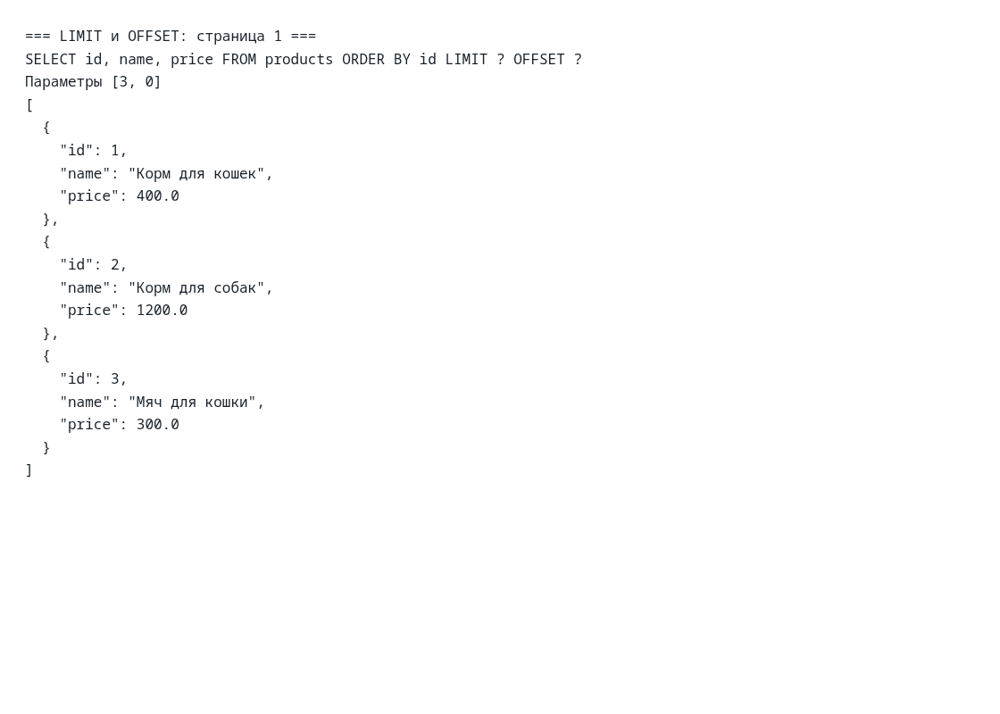


### 9. LIMIT и OFFSET: страница 2

Вторая страница содержит следующие три строки. OFFSET равен 3.


```text
SELECT id, name, price FROM products ORDER BY id LIMIT ? OFFSET ?
Параметры [3, 3]
[
  {
    "id": 4,
    "name": "Игрушка для собаки",
    "price": 600.0
  },
  {
    "id": 5,
    "name": "Миска",
    "price": 250.0
  },
  {
    "id": 6,
    "name": "Поводок",
    "price": 900.0
  }
]
```


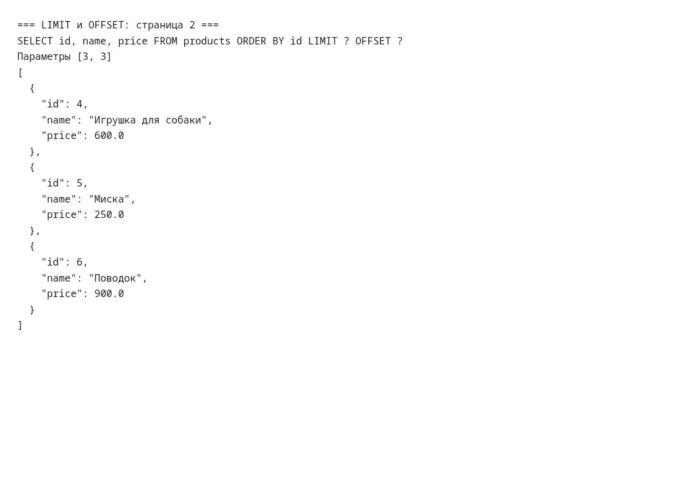


### 10. LIKE: поиск по подстроке

LIKE с шаблоном %Корм% находит два товара. Символ % допускает произвольную последовательность до и после подстроки. Встроенный LIKE не обеспечивает полное сравнение кириллицы без учёта регистра, поэтому шаблон соответствует написанию в данных.


```text
SELECT id, name FROM products WHERE name LIKE ? ORDER BY id
Параметры ["%Корм%"]
[
  {
    "id": 1,
    "name": "Корм для кошек"
  },
  {
    "id": 2,
    "name": "Корм для собак"
  }
]
```


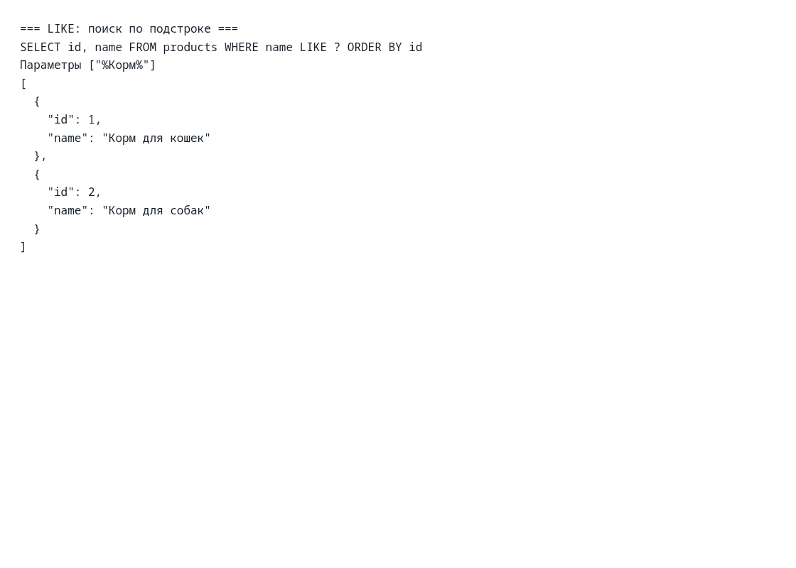


### 11. BETWEEN: диапазон цен

BETWEEN включает обе границы диапазона. Выбраны цены от 300 до 600 включительно.


```text
SELECT id, name, price FROM products WHERE price BETWEEN ? AND ? ORDER BY id
Параметры [300, 600]
[
  {
    "id": 1,
    "name": "Корм для кошек",
    "price": 400.0
  },
  {
    "id": 3,
    "name": "Мяч для кошки",
    "price": 300.0
  },
  {
    "id": 4,
    "name": "Игрушка для собаки",
    "price": 600.0
  }
]
```


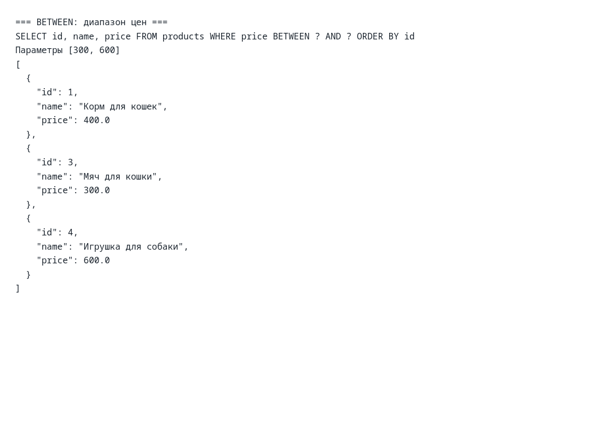


### 12. IN: товары выбранных категорий

IN отбирает товары категорий 1 и 3.


```text
SELECT id, name, category_id FROM products WHERE category_id IN (?, ?) ORDER BY id
Параметры [1, 3]
[
  {
    "id": 1,
    "name": "Корм для кошек",
    "category_id": 1
  },
  {
    "id": 2,
    "name": "Корм для собак",
    "category_id": 1
  },
  {
    "id": 5,
    "name": "Миска",
    "category_id": 3
  },
  {
    "id": 6,
    "name": "Поводок",
    "category_id": 3
  }
]
```


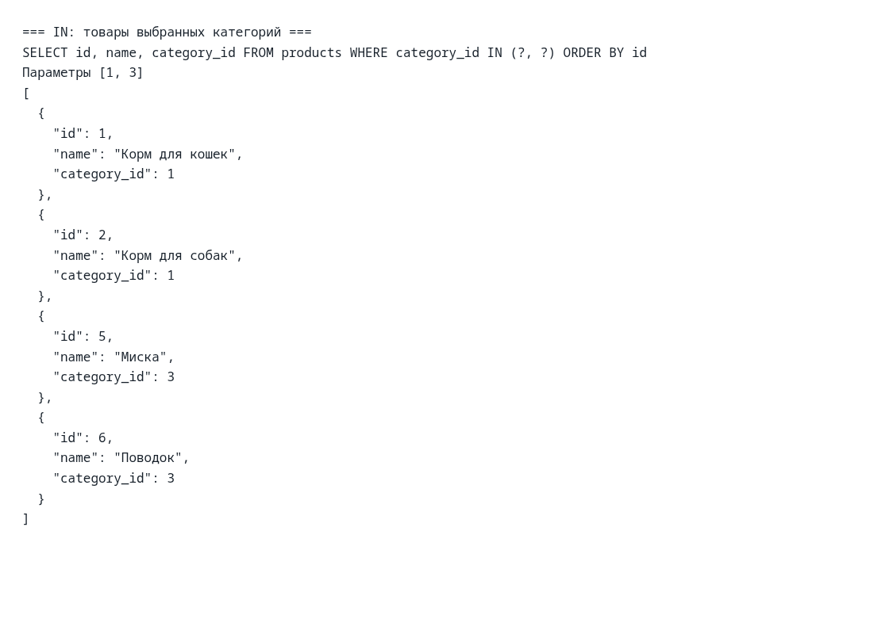


### 13. Агрегатные функции

COUNT равен 6, сумма цен равна 3650, средняя цена приблизительно 608.33, минимум 250, максимум 1200. SUM(price) складывает цены записей, независимо от складского остатка.


```text
SELECT COUNT(*) AS count, SUM(price) AS total_price, AVG(price) AS average_price, MIN(price) AS min_price, MAX(price) AS max_price FROM products
[
  {
    "count": 6,
    "total_price": 3650.0,
    "average_price": 608.3333333333334,
    "min_price": 250.0,
    "max_price": 1200.0
  }
]
```


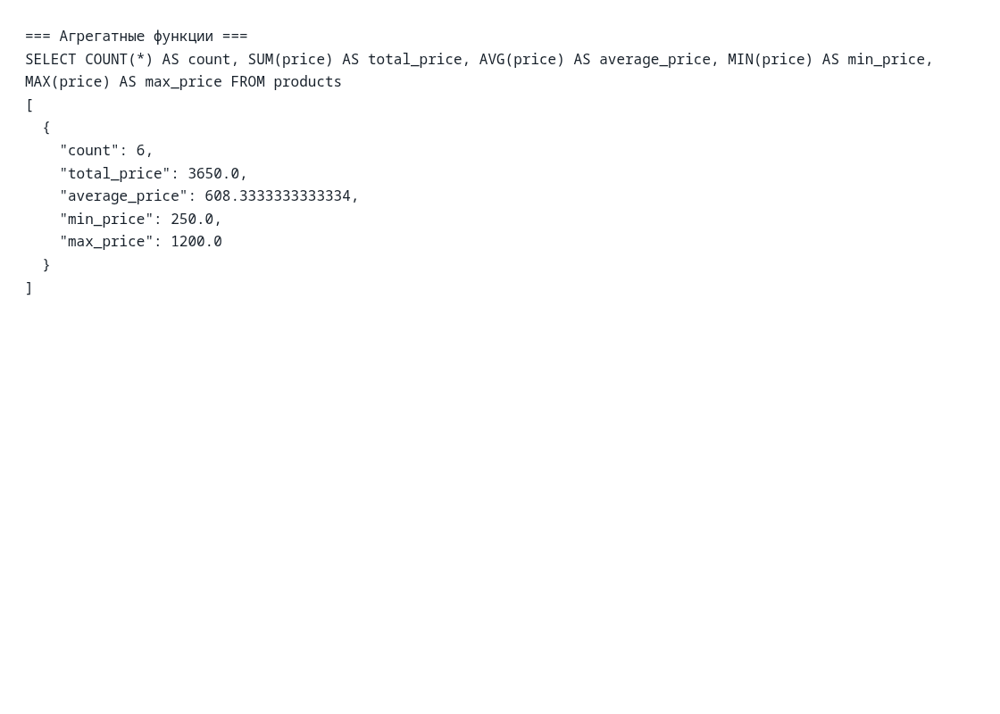


### 14. GROUP BY: товары по категориям

GROUP BY category_id формирует три группы товаров. В каждой группе две записи.


```text
SELECT category_id, COUNT(*) AS count, AVG(price) AS average_price FROM products GROUP BY category_id ORDER BY category_id
[
  {
    "category_id": 1,
    "count": 2,
    "average_price": 800.0
  },
  {
    "category_id": 2,
    "count": 2,
    "average_price": 450.0
  },
  {
    "category_id": 3,
    "count": 2,
    "average_price": 575.0
  }
]
```


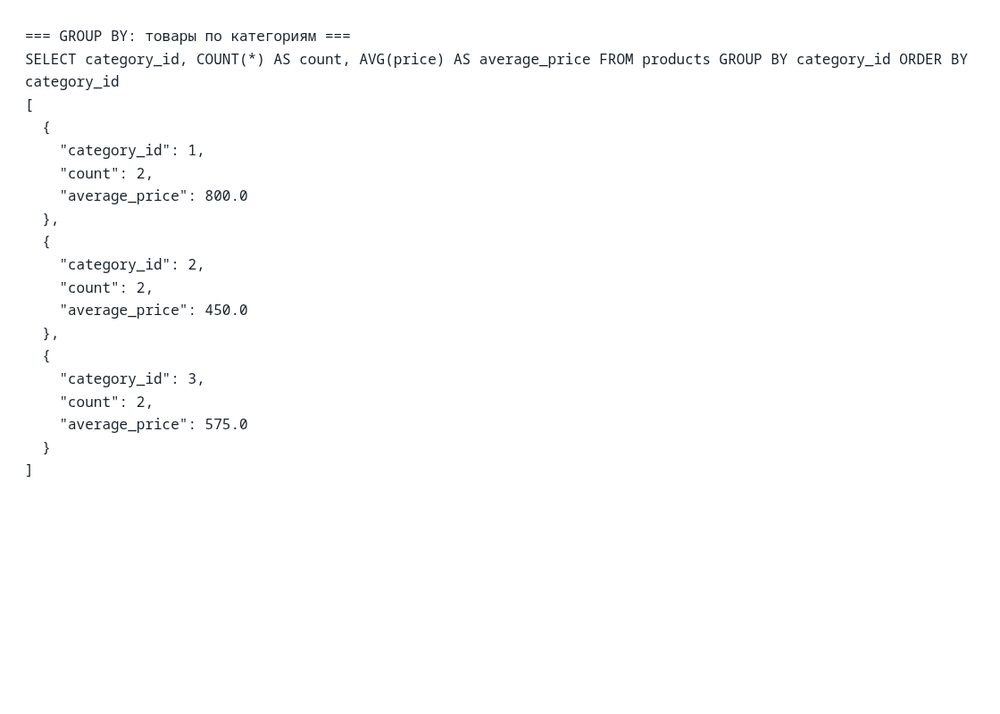


### 15. INNER JOIN: товары и категории

INNER JOIN добавляет к товару название его категории по совпадению products.category_id и categories.id.


```text
SELECT p.id, p.name, p.price, c.name AS category FROM products AS p INNER JOIN categories AS c ON c.id = p.category_id ORDER BY p.id
[
  {
    "id": 1,
    "name": "Корм для кошек",
    "price": 400.0,
    "category": "Корм"
  },
  {
    "id": 2,
    "name": "Корм для собак",
    "price": 1200.0,
    "category": "Корм"
  },
  {
    "id": 3,
    "name": "Мяч для кошки",
    "price": 300.0,
    "category": "Игрушки"
  },
  {
    "id": 4,
    "name": "Игрушка для собаки",
    "price": 600.0,
    "category": "Игрушки"
  },
  {
    "id": 5,
    "name": "Миска",
    "price": 250.0,
    "category": "Аксессуары"
  },
  {
    "id": 6,
    "name": "Поводок",
    "price": 900.0,
    "category": "Аксессуары"
  }
]
```


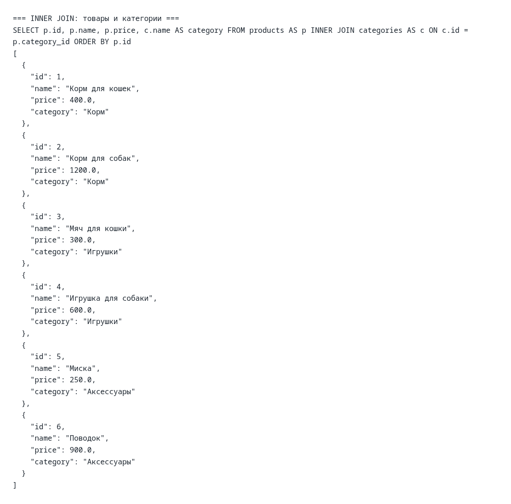


### 16. LEFT JOIN: все категории

LEFT JOIN сохраняет все четыре категории. У категории «Уход» product_count равен 0.


```text
SELECT c.name AS category, COUNT(p.id) AS product_count FROM categories AS c LEFT JOIN products AS p ON p.category_id = c.id GROUP BY c.id, c.name ORDER BY c.id
[
  {
    "category": "Корм",
    "product_count": 2
  },
  {
    "category": "Игрушки",
    "product_count": 2
  },
  {
    "category": "Аксессуары",
    "product_count": 2
  },
  {
    "category": "Уход",
    "product_count": 0
  }
]
```


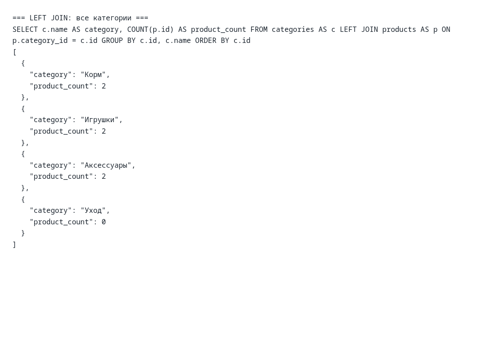


### 17. GROUP BY и HAVING

HAVING оставляет группы со средней ценой выше 500. Это категории «Корм» и «Аксессуары».


```text
SELECT c.name AS category, COUNT(p.id) AS product_count, AVG(p.price) AS average_price FROM categories AS c INNER JOIN products AS p ON p.category_id = c.id GROUP BY c.id, c.name HAVING AVG(p.price) > ? ORDER BY c.id
Параметры [500]
[
  {
    "category": "Корм",
    "product_count": 2,
    "average_price": 800.0
  },
  {
    "category": "Аксессуары",
    "product_count": 2,
    "average_price": 575.0
  }
]
```


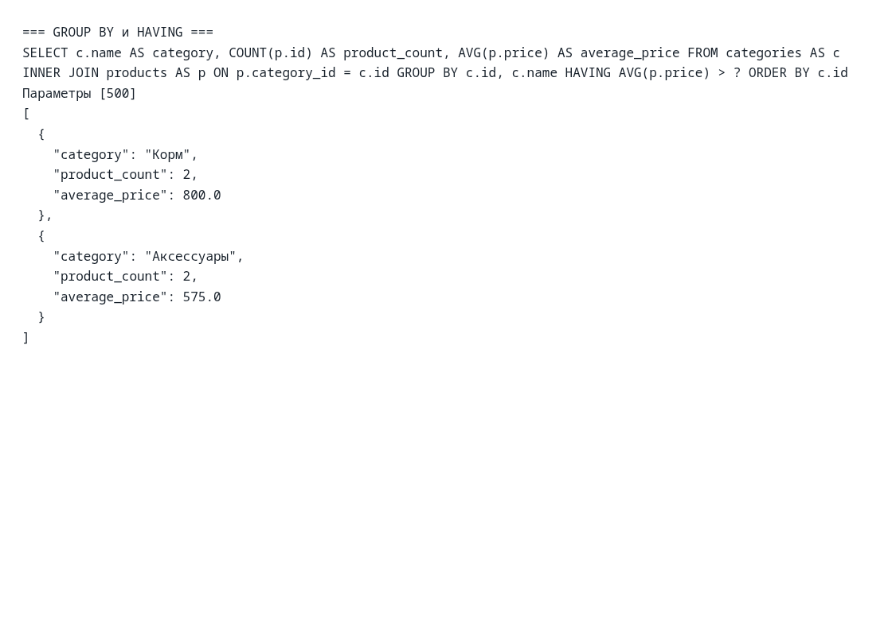


### 18. Подзапрос: цена выше средней

Подзапрос вычисляет среднюю цену, внешний SELECT выбирает товары дороже неё. Получены товары 2 и 6.


```text
SELECT id, name, price FROM products WHERE price > (SELECT AVG(price) FROM products) ORDER BY id
[
  {
    "id": 2,
    "name": "Корм для собак",
    "price": 1200.0
  },
  {
    "id": 6,
    "name": "Поводок",
    "price": 900.0
  }
]
```


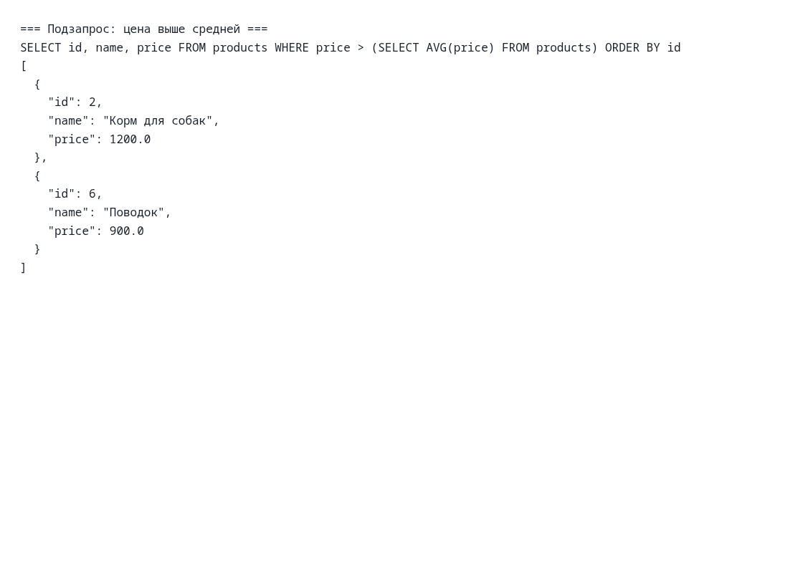


### 19. План индексного поиска

EXPLAIN QUERY PLAN показывает использование idx_products_category_price для отбора по category_id. План зависит от версии SQLite и статистики базы.


```text
EXPLAIN QUERY PLAN SELECT id, name, price FROM products WHERE category_id = ? ORDER BY price
Параметры [1]
[
  {
    "id": 4,
    "parent": 0,
    "notused": 62,
    "detail": "SEARCH products USING INDEX idx_products_category_price (category_id=?)"
  }
]
```


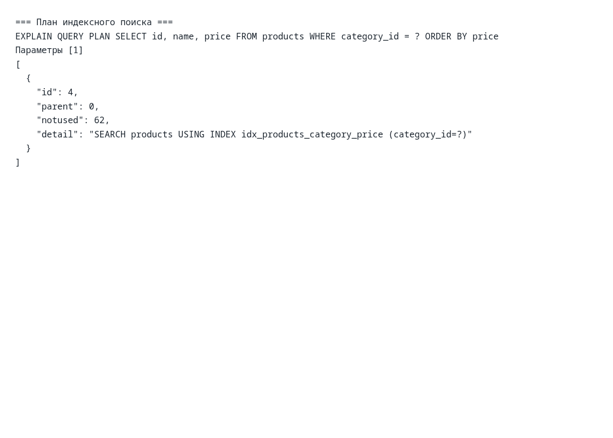


### 20. UPDATE и DELETE

BEGIN открывает транзакцию. UPDATE меняет цену товара 1 на 450, DELETE удаляет товар 6. COMMIT подтверждает изменения.


```text
BEGIN
UPDATE products SET price = ? WHERE id = ?
Параметры [450, 1]
DELETE FROM products WHERE id = ?
Параметры [6]
Удалено записей 1
COMMIT
```


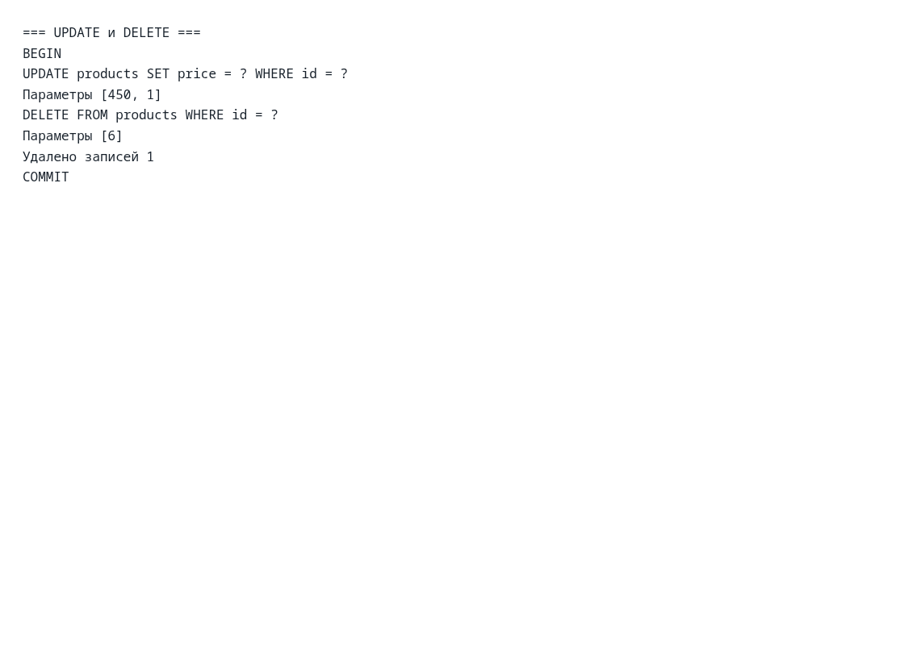


### 21. Состояние после COMMIT

После COMMIT осталось пять товаров. Изменённая цена товара 1 сохранена.


```text
SELECT id, name, price, stock, category_id FROM products ORDER BY id
[
  {
    "id": 1,
    "name": "Корм для кошек",
    "price": 450.0,
    "stock": 12,
    "category_id": 1
  },
  {
    "id": 2,
    "name": "Корм для собак",
    "price": 1200.0,
    "stock": 8,
    "category_id": 1
  },
  {
    "id": 3,
    "name": "Мяч для кошки",
    "price": 300.0,
    "stock": 0,
    "category_id": 2
  },
  {
    "id": 4,
    "name": "Игрушка для собаки",
    "price": 600.0,
    "stock": 5,
    "category_id": 2
  },
  {
    "id": 5,
    "name": "Миска",
    "price": 250.0,
    "stock": 10,
    "category_id": 3
  }
]
```


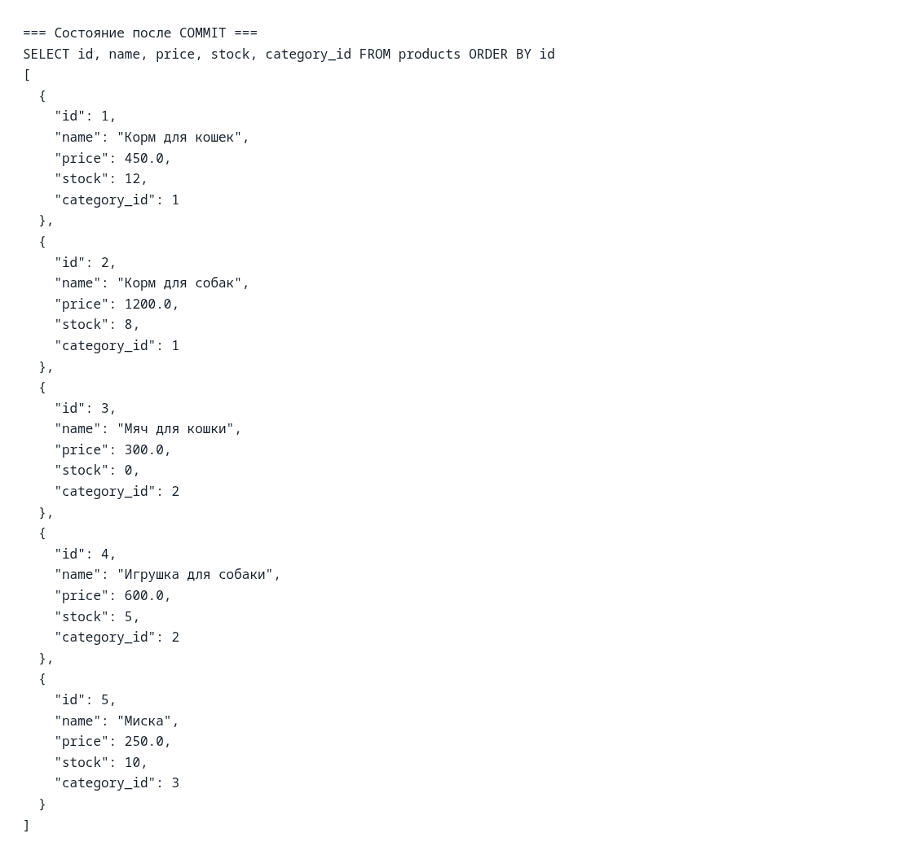


### 22. Транзакция, завершённая ROLLBACK

Вторая команда нарушает CHECK для stock. Ошибка обрабатывается, ROLLBACK отменяет и первую успешную команду транзакции.


```text
BEGIN
UPDATE products SET stock = stock + 1 WHERE id = 1
UPDATE products SET stock = -1 WHERE id = 2
Нарушено ограничение: CHECK constraint failed: typeof(stock) = 'integer' AND stock >= 0
ROLLBACK
```


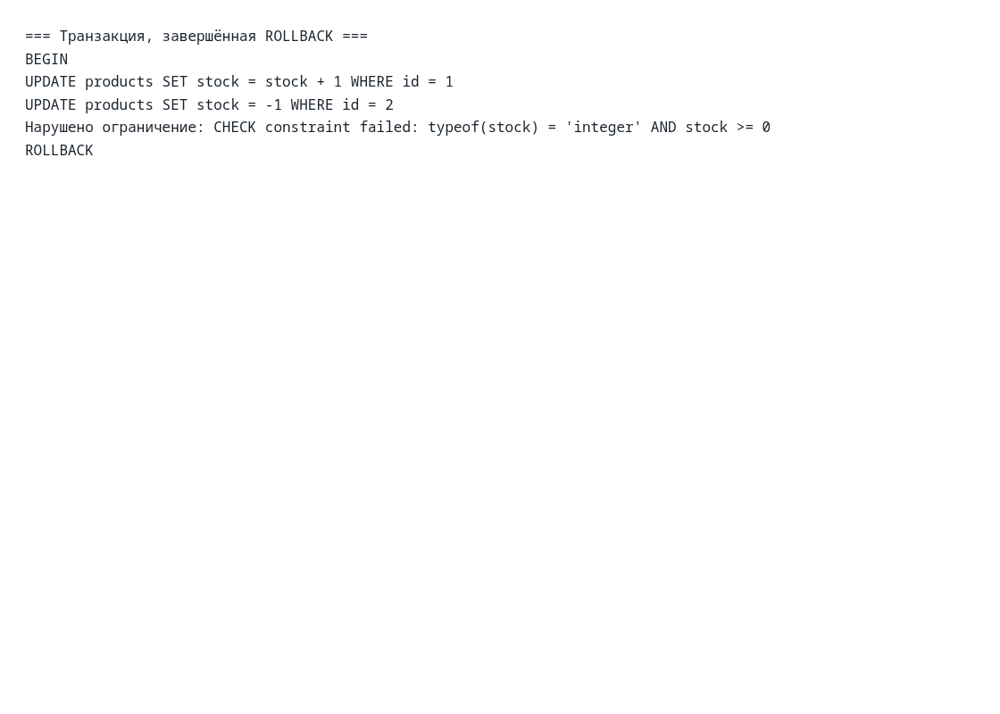


### 23. Остатки после ROLLBACK

После отката остатки товаров 1 и 2 равны 12 и 8. Промежуточное увеличение остатка товара 1 не сохранилось.


```text
SELECT id, stock FROM products WHERE id IN (?, ?) ORDER BY id
Параметры [1, 2]
[
  {
    "id": 1,
    "stock": 12
  },
  {
    "id": 2,
    "stock": 8
  }
]
```


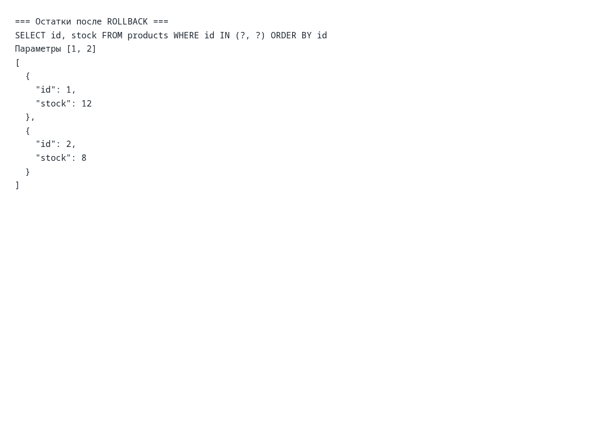


## Контрольные вопросы

### 1. Что такое SQL и SQLite?

SQL - язык определения структуры и обработки данных в реляционных базах. SQLite - встроенная СУБД, выполняющая SQL и сохраняющая базу в файле. Для SQLite отдельный сервер не требуется.

### 2. Что такое PRIMARY KEY и AUTOINCREMENT?

PRIMARY KEY однозначно определяет строку таблицы. INTEGER PRIMARY KEY связан с внутренним rowid SQLite. AUTOINCREMENT предотвращает повторную автоматическую выдачу ранее использованных подтверждённых идентификаторов и хранит последовательность в sqlite_sequence.

### 3. Что такое FOREIGN KEY?

Внешний ключ требует, чтобы category_id товара соответствовал существующей категории. Это предотвращает появление товара с отсутствующей категорией. Во SQLite проверка включается командой PRAGMA foreign_keys = ON для каждого соединения.

### 4. Чем INNER JOIN отличается от LEFT JOIN?

INNER JOIN возвращает совпавшие пары строк. LEFT JOIN сохраняет каждую строку левой таблицы, заполняя столбцы правой таблицы значением NULL при отсутствии соответствия. В работе так выводится категория «Уход» без товаров.

### 5. Чем WHERE отличается от HAVING?

WHERE фильтрует отдельные строки до группировки. HAVING фильтрует уже сформированные группы и может использовать AVG или COUNT. В работе HAVING AVG(p.price) > 500 отбирает категории по средней цене.

### 6. Что такое подзапрос?

Это SELECT внутри другого SQL-запроса. В работе внутренний SELECT AVG(price) FROM products вычисляет среднюю цену, внешний SELECT получает товары дороже неё.

### 7. Что делают BEGIN, COMMIT и ROLLBACK?

BEGIN открывает транзакцию. COMMIT подтверждает изменения, ROLLBACK отменяет их. Если одна команда транзакции не проходит проверку CHECK, программа явно откатывает всю группу изменений.

### 8. Что такое индекс?

Индекс - дополнительная структура для поиска по значениям столбцов. Составной индекс category_id, price помогает находить товары категории в порядке цены. Индекс занимает место и требует обновления при изменении данных.

### 9. Как организованы миграции?

Схема создаётся отдельным init_db.sql. Номер версии хранится в user_version. При открытии пустой базы применяется первая миграция, при версии 1 данные сохраняются. В дальнейшем каждой версии может соответствовать отдельный SQL-скрипт перехода.

### 10. Что такое нормализация?

Нормализация уменьшает избыточность и зависимости между данными. В первой нормальной форме значения полей атомарны. Вторая исключает зависимости от части составного ключа. Третья исключает транзитивные зависимости неключевых атрибутов. В работе названия категорий вынесены в отдельную таблицу, товары хранят её ID.

### 11. Как избежать SQL-инъекций?

Использовать параметры запроса. В cursor.execute SQL содержит ?, значения передаются отдельным кортежем. СУБД воспринимает значение как данные. Имена таблиц и столбцов параметрами не подставляются.

### 12. Для чего EXPLAIN QUERY PLAN?

Команда показывает выбранный SQLite способ доступа к данным, включая сканирование и использование индексов. Для отбора по category_id план показывает индекс idx_products_category_price. Это подтверждает выбор индекса, фактическое ускорение зависит от размера данных и нагрузки.

### 13. Как реализовать пагинацию?

Задать устойчивую сортировку, LIMIT и OFFSET. Для страницы page размером limit смещение равно (page - 1) × limit. В работе первая страница имеет LIMIT 3 OFFSET 0, вторая LIMIT 3 OFFSET 3.

### 14. Как оптимизировать SQL-запросы?

Выбирать нужные столбцы, ограничивать объём результата и создавать индексы под условия поиска и соединения таблиц. Проверять план выполнения и учитывать стоимость изменения индексов при записи.

## Вывод

Создана база SQLite для товаров и категорий. Выполнены создание и заполнение таблиц, чтение, обновление, удаление, фильтрация, сортировка и пагинация. Освоены агрегатные функции, группировка, объединения таблиц и подзапросы. Ограничения данных предотвращают недопустимые записи, внешний ключ сохраняет связи, транзакции обеспечивают согласованное выполнение нескольких изменений. Проверено сохранение данных после повторного открытия файла базы.
